# Lab 01 - Configure your Microsoft Sentinel environment

Hands-on lab for the **SC-500** preparation. This repo documents each step I did in the Azure portal, with screenshots and an explanation of every term.

## Scenario

Deploy a Microsoft Sentinel workspace that meets these requirements:

- Sentinel data is stored in the **West US** Azure region.
- All Sentinel analytics logs are retained for **180 days**.
- **Operator1** can manage incidents and run Sentinel playbooks, following the **principle of least privilege**.

## Architecture

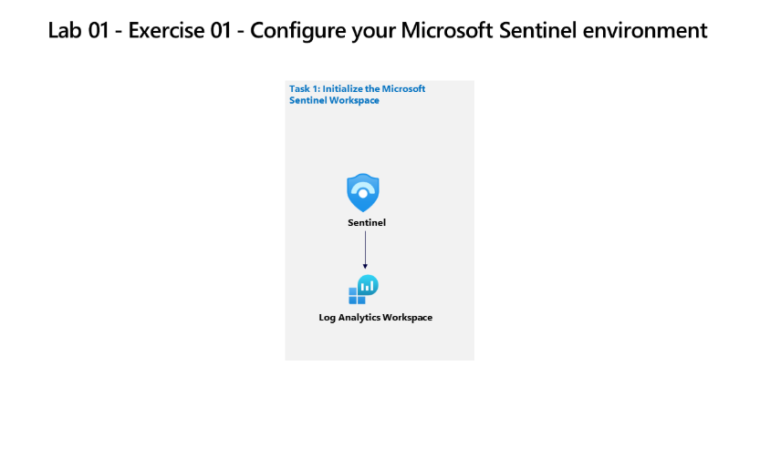

Microsoft Sentinel is not a standalone resource. It is a solution enabled **on top of a Log Analytics workspace**. The workspace stores the data, and Sentinel adds detection, investigation and response.

> Analogy: the Log Analytics workspace is an empty building. Sentinel is the security control room installed inside it.

## Key terms

| Term | Meaning |
|---|---|
| **Microsoft Sentinel** | Cloud-native **SIEM** (Security Information and Event Management) and **SOAR** (Security Orchestration, Automation and Response). Collects logs, detects threats, helps investigate and respond. |
| **Log Analytics workspace** | Azure container that stores log data. You query it with KQL (Kusto Query Language). Sentinel needs one. |
| **Resource group (RG2)** | A folder-like logical container for Azure resources. Roles assigned on it are inherited by the resources inside. |
| **Region (West US)** | Physical location where the workspace and its data are stored. Chosen at creation, cannot be changed later. |
| **Azure RBAC** | Role-Based Access Control. Gives a user a role at a given scope. |
| **Scope** | Level where a role applies: management group > subscription > resource group > resource. |
| **Least privilege** | Give a user only the permissions needed for the job, nothing more. |
| **Incident** | A group of related alerts that an analyst investigates in Sentinel. |
| **Playbook** | An automated workflow (built with Azure Logic Apps) that responds to an alert or incident. |
| **Data retention** | How long data stays available for queries in the workspace. |

---

## Task 1 - Create a Log Analytics workspace

**Goal:** create the container that will hold the data, in the right region.

### Step 1: search for Microsoft Sentinel

In the Azure portal, search for **Microsoft Sentinel** and open it.

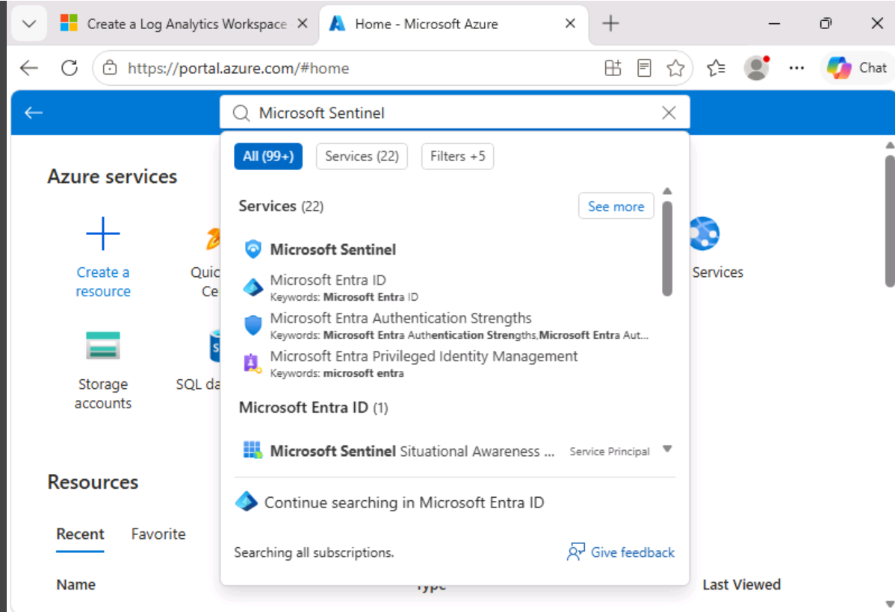

### Step 2: click Create

Click **+ Create**, then **Create a new workspace**.

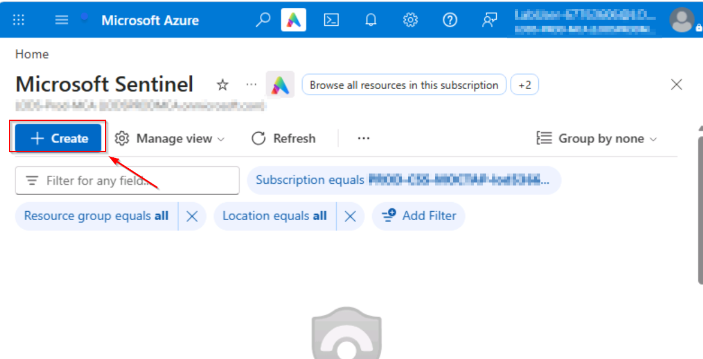

### Step 3: fill in the basics

- Subscription: the lab subscription
- Resource group: **RG2**
- Name: `Cybertechsali-log`
- Region: **West US**

Then click **Review + Create**.

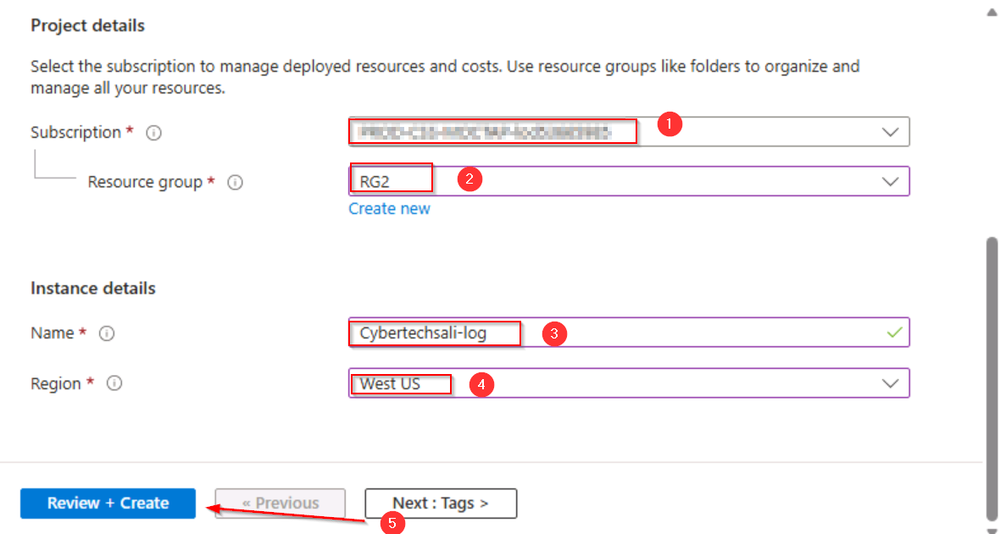

### Step 4: validation

Wait for **Validation passed**, then click **Create**.

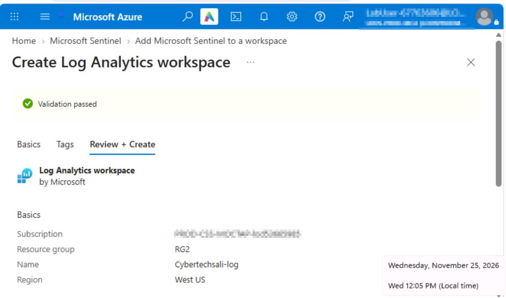

### Step 5: deployment

The deployment starts, then finishes with "Your deployment is complete".

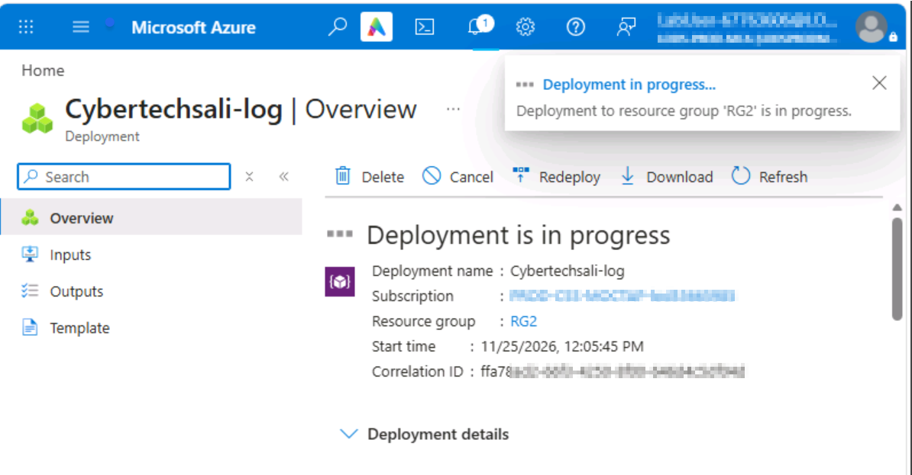

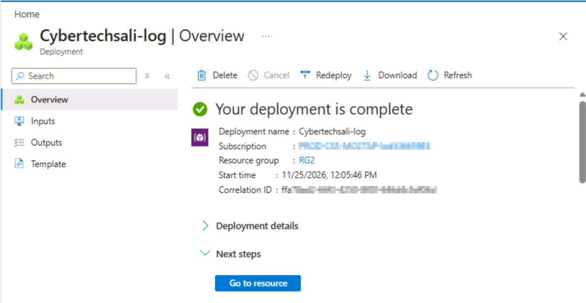

**Why it matters:** the region chosen here satisfies the requirement "data stored in West US".

---

## Task 2 - Deploy Microsoft Sentinel to the workspace

**Goal:** enable Sentinel on the workspace created in Task 1.

### Step 1: click Create again

The Sentinel page is empty because it only lists workspaces that **already have Sentinel enabled**. Click **+ Create**.

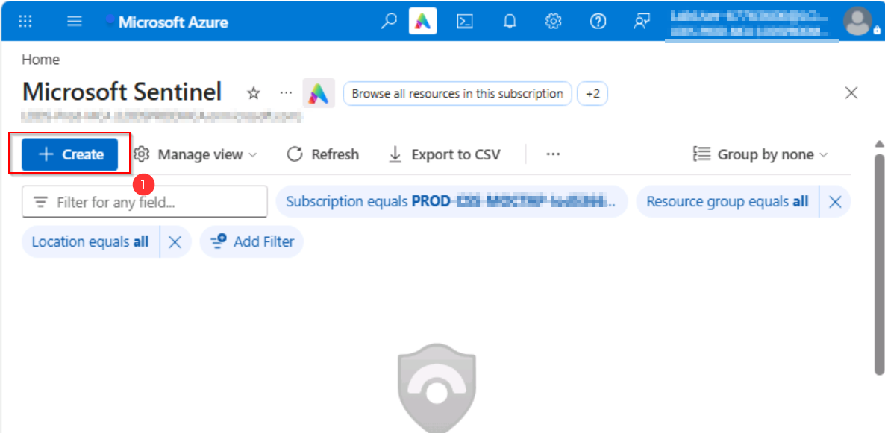

### Step 2: select the workspace and click Add

Select `Cybertechsali-log` (click **Refresh** if it is missing), then click **Add**.


### Step 3: Sentinel is enabled

The workspace now appears in the Sentinel list.


---

## Task 3 - Assign a Sentinel role to Operator1

**Goal:** let Operator1 manage incidents and run playbooks.

### Step 1: open IAM on the resource group

Go to **RG2 > Access control (IAM) > Add > Add role assignment**.


### Step 2: choose the role

Search for **Microsoft Sentinel Contributor**, select it and click **Next**.


### Step 3: select the member

Choose **User, group, or service principal**, click **+ Select members**, search for Operator1, select the user and click **Select**.

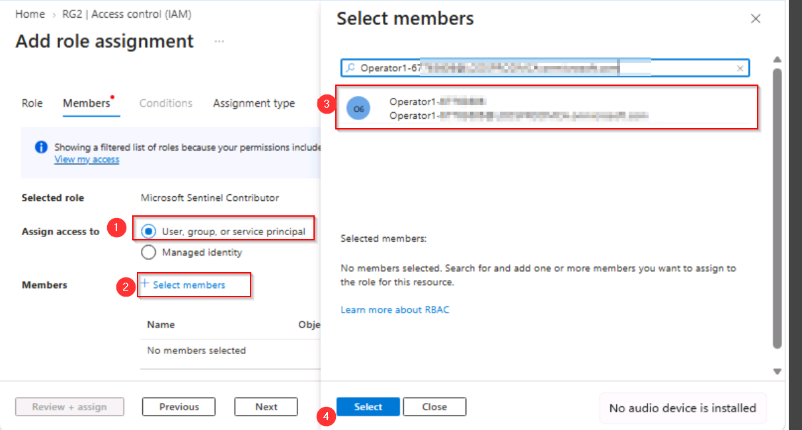

### Step 4: review the members


### Step 5: review and assign

Click **Review + assign** twice to finish.

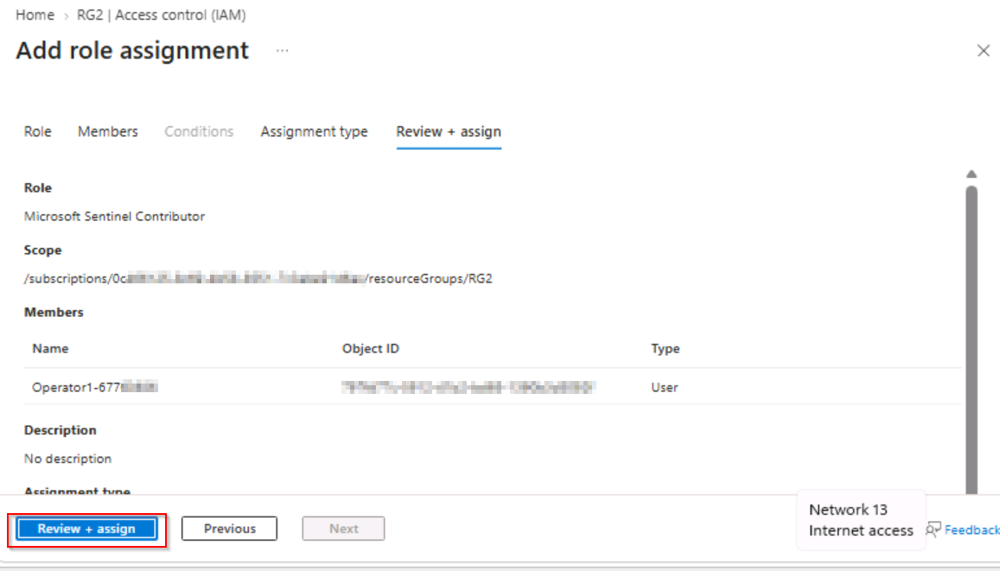

### Sentinel built-in roles

| Role | What it allows |
|---|---|
| **Microsoft Sentinel Reader** | View data, incidents, workbooks. No changes. |
| **Microsoft Sentinel Responder** | Reader + manage incidents (assign, dismiss, change severity). |
| **Microsoft Sentinel Contributor** | Responder + create and edit workbooks, analytics rules and other resources. |
| **Microsoft Sentinel Playbook Operator** | List and **run** playbooks. |
| **Microsoft Sentinel Automation Contributor** | Used by Sentinel itself to attach playbooks to automation rules, not for users. |

> **Note for the exam:** the lab answer is **Microsoft Sentinel Contributor** on the resource group. In a strict least-privilege reading, "manage incidents" maps to **Responder** and "run playbooks" maps to **Playbook Operator**. Read the question carefully: if the answer choices include Responder + Playbook Operator, that combination is the most precise.

**Why assign on the resource group?** The role is inherited by the workspace inside RG2, so Operator1 gets access to Sentinel without having rights on the whole subscription.

---

## Task 4 - Configure data retention

**Goal:** keep analytics logs for 180 days.

### Step 1: open Usage and estimated costs

Open the Log Analytics workspace, search for **Usage and estimated costs**, then click **Data Retention**.


### Step 2: set 180 days

Move the slider to **180** days and click **OK**.

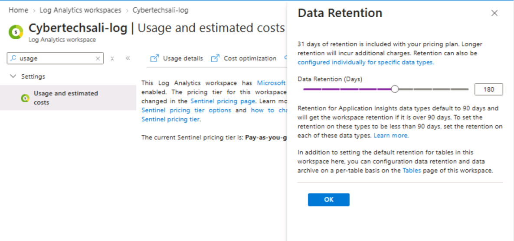

**Why it matters:** the default is 31 days included in the pricing plan. Longer retention adds a cost. Retention can also be set per table on the **Tables** page of the workspace.

> **Retention vs archive:** *interactive retention* keeps data queryable in the workspace. *Archive* (total retention) keeps older data at a lower cost, but you must run a search job or restore it to query it.

---

## Final result

| Requirement | How it was met |
|---|---|
| Data stored in West US | Workspace created with region **West US** (Task 1) |
| Analytics logs kept 180 days | Data retention set to **180** days (Task 4) |
| Operator1 manages incidents and runs playbooks | Role assigned on **RG2** (Task 3) |
| Least privilege | Role limited to the resource group, no subscription-wide rights |

## Quick exam reminders

- Sentinel = **SIEM + SOAR**, built **on a Log Analytics workspace**.
- The workspace region is chosen at creation.
- Manage incidents only? **Responder**. Run playbooks? **Playbook Operator**. Edit rules and workbooks too? **Contributor**.
- Default retention is short, so extend it in **Usage and estimated costs > Data Retention**.

## Repo structure

```
Lab 01 - Configure your Microsoft Sentinel environment/
├── README.md
└── images/
    ├── 1.png
    ├── 2.png
    └── ... up to 17.png
```
