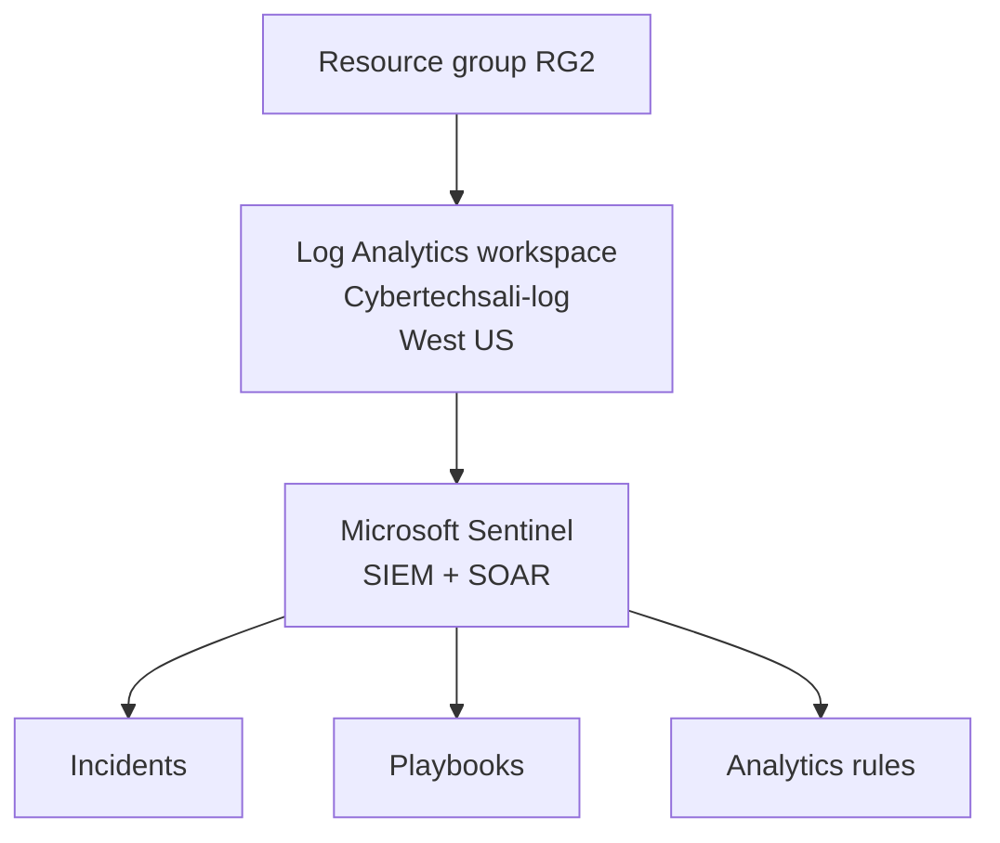
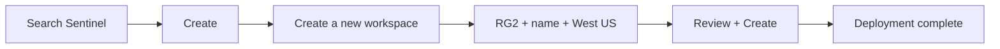
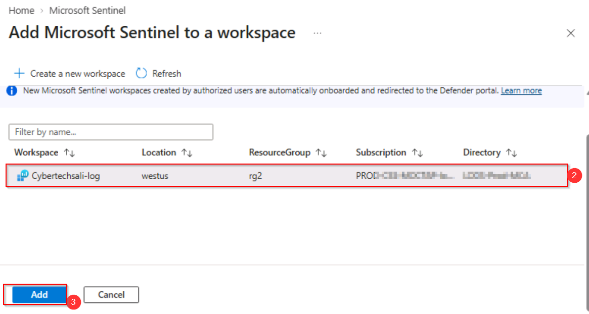
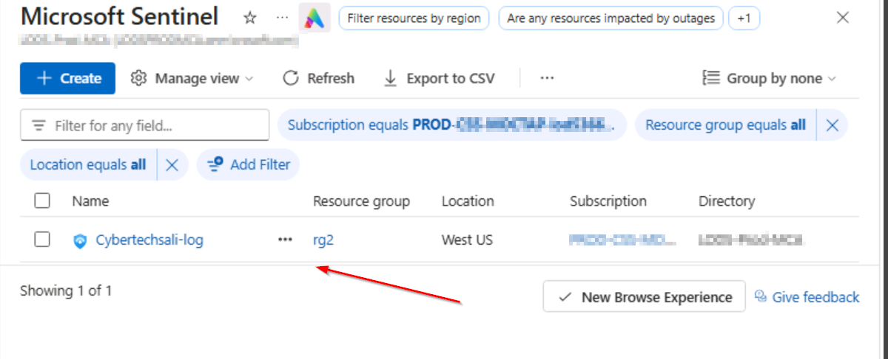
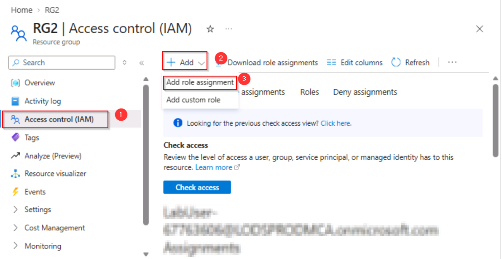
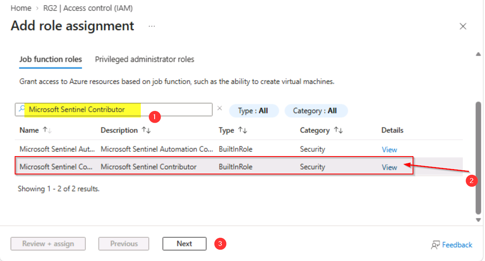
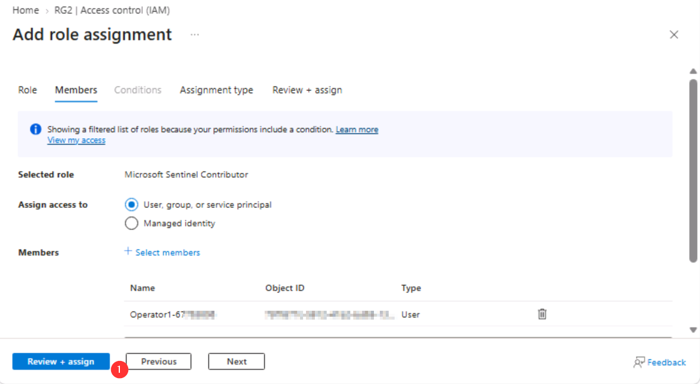
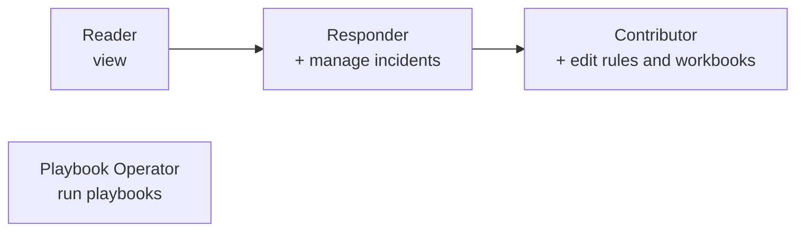
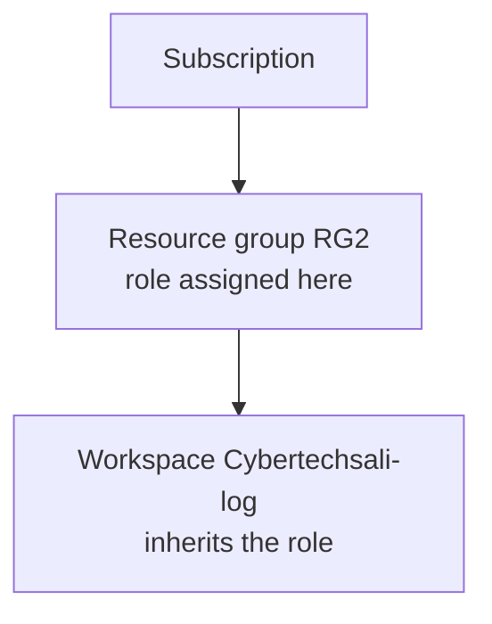
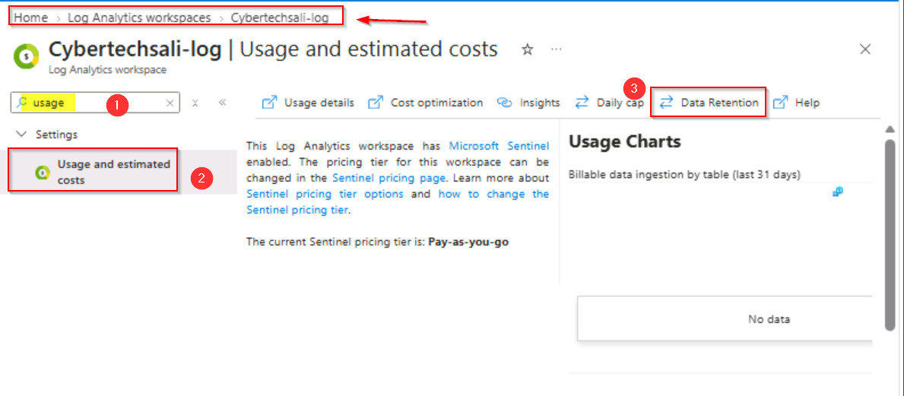

<div align="center">

# 🛡️ Lab 01: Configure your Microsoft Sentinel environment


*Hands-on lab documented step by step, with screenshots and explanations of every term.*

</div>

---

## 👤 About

| | |
|---|---|
| 🎯 **Goal** | Preparation for the Microsoft **SC-500** certification (Cloud and AI Security Engineer Associate) |
| ✍️ **Author** | Ouchahed Salma |
| 🐙 **GitHub** | CyberTechSali |
| 🎓 **Training** | [LevelUp for Microsoft - SC-500: Cloud and AI Security Engineer Associate - Practice Lab](https://learn.mslevelup.com/learner_module/show/2621860?lesson_id=12220419&section_id=109230742) (SkillUp) |
| 📅 **Date** | November 25, 2026 |

> 📌 The lab scenario and architecture diagram come from the training material. The screenshots and explanations are my own.

---

## 📑 Table of contents

1. [Scenario](#-scenario)
2. [Architecture](#-architecture)
3. [Key terms](#-key-terms)
4. [Task 1: Create a Log Analytics workspace](#-task-1-create-a-log-analytics-workspace)
5. [Task 2: Deploy Microsoft Sentinel](#-task-2-deploy-microsoft-sentinel-to-the-workspace)
6. [Task 3: Assign a role to Operator1](#-task-3-assign-a-sentinel-role-to-operator1)
7. [Task 4: Configure data retention](#-task-4-configure-data-retention)
8. [Final result](#-final-result)
9. [Exam reminders](#-exam-reminders)

---

## 🎯 Scenario

Deploy a Microsoft Sentinel workspace that meets these requirements:

| # | Requirement | Solved in |
|---|---|---|
| 1 | 🌎 Sentinel data is stored in the **West US** Azure region | Task 1 |
| 2 | 🕒 All Sentinel analytics logs are retained for **180 days** | Task 4 |
| 3 | 👤 **Operator1** can manage incidents and run Sentinel playbooks, with **least privilege** | Task 3 |

---

## 🏗️ Architecture

<div align="center">

</div>

Microsoft Sentinel is not a standalone resource. It is a solution enabled **on top of a Log Analytics workspace**. The workspace stores the data, and Sentinel adds detection, investigation and response.



> 💡 **Analogy:** the Log Analytics workspace is an empty building. Sentinel is the security control room installed inside it.

---

## 📖 Key terms

| Term | Meaning |
|---|---|
| 🛡️ **Microsoft Sentinel** | Cloud-native **SIEM** (Security Information and Event Management) and **SOAR** (Security Orchestration, Automation and Response). Collects logs, detects threats, helps investigate and respond. |
| 🗄️ **Log Analytics workspace** | Azure container that stores log data. You query it with KQL (Kusto Query Language). Sentinel needs one. |
| 📁 **Resource group (RG2)** | A folder-like logical container for Azure resources. Roles assigned on it are inherited by the resources inside. |
| 🌎 **Region (West US)** | Physical location where the workspace and its data are stored. Chosen at creation, cannot be changed later. |
| 🔑 **Azure RBAC** | Role-Based Access Control. Gives a user a role at a given scope. |
| 🎚️ **Scope** | Level where a role applies: management group > subscription > resource group > resource. |
| 🔒 **Least privilege** | Give a user only the permissions needed for the job, nothing more. |
| 🚨 **Incident** | A group of related alerts that an analyst investigates in Sentinel. |
| ⚙️ **Playbook** | An automated workflow (built with Azure Logic Apps) that responds to an alert or incident. |
| 🕒 **Data retention** | How long data stays available for queries in the workspace. |

---

## 🧱 Task 1: Create a Log Analytics workspace

> 🎯 **Goal:** create the container that will hold the data, in the right region.



### 1️⃣ Search for Microsoft Sentinel

In the Azure portal, search for **Microsoft Sentinel** and open it.

<div align="center">

</div>

### 2️⃣ Click Create

Click **+ Create**, then **Create a new workspace**.

<div align="center">

</div>

### 3️⃣ Fill in the basics

| Field | Value |
|---|---|
| Subscription | the lab subscription |
| Resource group | **RG2** |
| Name | `Cybertechsali-log` |
| Region | **West US** |

Then click **Review + Create**.

<div align="center">

</div>

### 4️⃣ Validation

Wait for **Validation passed**, then click **Create**.

<div align="center">

</div>

### 5️⃣ Deployment

The deployment starts, then finishes with "Your deployment is complete".

<div align="center">


</div>

✅ **Why it matters:** the region chosen here satisfies the requirement "data stored in West US".

---

## 🚀 Task 2: Deploy Microsoft Sentinel to the workspace

> 🎯 **Goal:** enable Sentinel on the workspace created in Task 1.

### 1️⃣ Click Create again

The Sentinel page is empty because it only lists workspaces that **already have Sentinel enabled**. Click **+ Create**.

<div align="center">

</div>

### 2️⃣ Select the workspace and click Add

Select `Cybertechsali-log` (click **Refresh** if it is missing), then click **Add**.

<div align="center">

</div>

### 3️⃣ Sentinel is enabled

The workspace now appears in the Sentinel list.

<div align="center">

</div>

---

## 👥 Task 3: Assign a Sentinel role to Operator1

> 🎯 **Goal:** let Operator1 manage incidents and run playbooks.

### 1️⃣ Open IAM on the resource group

Go to **RG2 > Access control (IAM) > Add > Add role assignment**.

<div align="center">

</div>

### 2️⃣ Choose the role

Search for **Microsoft Sentinel Contributor**, select it and click **Next**.

<div align="center">

</div>

### 3️⃣ Select the member

Choose **User, group, or service principal**, click **+ Select members**, search for Operator1, select the user and click **Select**.

<div align="center">

</div>

### 4️⃣ Review the members

<div align="center">

</div>

### 5️⃣ Review and assign

Click **Review + assign** twice to finish.

<div align="center">

</div>

### 🔑 Sentinel built-in roles

| Role | What it allows |
|---|---|
| 👁️ **Microsoft Sentinel Reader** | View data, incidents, workbooks. No changes. |
| 🚨 **Microsoft Sentinel Responder** | Reader + manage incidents (assign, dismiss, change severity). |
| ✏️ **Microsoft Sentinel Contributor** | Responder + create and edit workbooks, analytics rules and other resources. |
| ▶️ **Microsoft Sentinel Playbook Operator** | List and **run** playbooks. |
| 🤖 **Microsoft Sentinel Automation Contributor** | Used by Sentinel itself to attach playbooks to automation rules, not for users. |



> ⚠️ **Note for the exam:** the lab answer is **Microsoft Sentinel Contributor** on the resource group. In a strict least-privilege reading, "manage incidents" maps to **Responder** and "run playbooks" maps to **Playbook Operator**. Read the question carefully: if the answer choices include Responder + Playbook Operator, that combination is the most precise.

**Why assign on the resource group?** The role is inherited by the workspace inside RG2, so Operator1 gets access to Sentinel without having rights on the whole subscription.



---

## 🕒 Task 4: Configure data retention

> 🎯 **Goal:** keep analytics logs for 180 days.

### 1️⃣ Open Usage and estimated costs

Open the Log Analytics workspace, search for **Usage and estimated costs**, then click **Data Retention**.

<div align="center">

</div>

### 2️⃣ Set 180 days

Move the slider to **180** days and click **OK**.

<div align="center">

</div>

✅ **Why it matters:** the default is 31 days included in the pricing plan. Longer retention adds a cost. Retention can also be set per table on the **Tables** page of the workspace.

<details>
<summary>📦 <b>Retention vs archive (click to expand)</b></summary>

<br>

- **Interactive retention** keeps data queryable in the workspace.
- **Archive** (total retention) keeps older data at a lower cost, but you must run a search job or restore it to query it.

</details>

---

## ✅ Final result

| Requirement | How it was met | Status |
|---|---|---|
| Data stored in West US | Workspace created with region **West US** (Task 1) | ✅ |
| Analytics logs kept 180 days | Data retention set to **180** days (Task 4) | ✅ |
| Operator1 manages incidents and runs playbooks | Role assigned on **RG2** (Task 3) | ✅ |
| Least privilege | Role limited to the resource group, no subscription-wide rights | ✅ |

---

## 🧠 Exam reminders

- 🛡️ Sentinel = **SIEM + SOAR**, built **on a Log Analytics workspace**.
- 🌎 The workspace region is chosen at creation.
- 🚨 Manage incidents only? **Responder**. ▶️ Run playbooks? **Playbook Operator**. ✏️ Edit rules and workbooks too? **Contributor**.
- 🕒 Default retention is short, so extend it in **Usage and estimated costs > Data Retention**.

---

## 🗂️ Repo structure

```
Lab 01 - Configure your Microsoft Sentinel environment/
├── README.md
└── images/
    ├── 1.png
    ├── 2.png
    └── ... up to 17.png
```
