<div align="center">

# 🔌 Lab 02: Connect data to Microsoft Sentinel using data connectors


*Hands-on lab documented step by step, with screenshots and explanations of every term.*

</div>

---

## 👤 About

| | |
|---|---|
| 🎯 **Goal** | Preparation for the Microsoft **SC-500** certification (Cloud and AI Security Engineer Associate) |
| ✍️ **Author** | Ouchahed Salma |
| 🐙 **GitHub** | CyberTechSali |
| 🎓 **Training** | [LevelUp for Microsoft - SC-500: Cloud and AI Security Engineer Associate - Practice Lab](https://learn.mslevelup.com/learner_module/show/2621860?lesson_id=12220419&section_id=109230742) (SkillUp) |
| 📅 **Date** | November 26, 2026 |
| 🔗 **Previous lab** | Lab 01: the Log Analytics workspace `Cybertechsali-log` and Microsoft Sentinel were created there |

> 📌 The lab scenario and architecture diagram come from the training material. The screenshots and explanations are my own.

---

## 📑 Table of contents

1. [Scenario](#-scenario)
2. [Architecture](#-architecture)
3. [Key terms](#-key-terms)
4. [Task 1: Install the Content hub solutions](#-task-1-install-the-content-hub-solutions)
5. [Task 2: Configure the Azure Activity data connector](#-task-2-configure-the-azure-activity-data-connector)
6. [Task 3: Configure the Defender for Cloud connector](#-task-3-configure-the-microsoft-defender-for-cloud-connector)
7. [Task 4: Enable an analytics rule](#-task-4-enable-an-analytics-rule)
8. [Task 5: Make the workbook available in My workbooks](#-task-5-make-the-azure-activity-workbook-available-in-my-workbooks)
9. [Final result](#-final-result)
10. [Exam reminders](#-exam-reminders)

---

## 🎯 Scenario

Deploy Content hub solutions in the Microsoft Sentinel workspace and meet these requirements:

| # | Requirement | Solved in |
|---|---|---|
| 1 | 📦 Install the solutions **Windows Security Events**, **Azure Activity** and **Microsoft Defender for Cloud** | Task 1 |
| 2 | ☁️ Configure the **Azure Activity** data connector to apply to **all new and existing resources** in the subscription | Task 2 |
| 3 | 🛡️ Configure the **Defender for Cloud** data connector to connect to the Azure subscription, with **only bi-directional sync** enabled | Task 3 |
| 4 | 🚨 Enable an analytics rule from the template **Suspicious number of resource creation or deployment activities**. It runs **every hour** and looks up data for the **last hour only** | Task 4 |
| 5 | 📊 The **Azure Activity workbook** is available in **My workbooks** | Task 5 |

<div align="center">
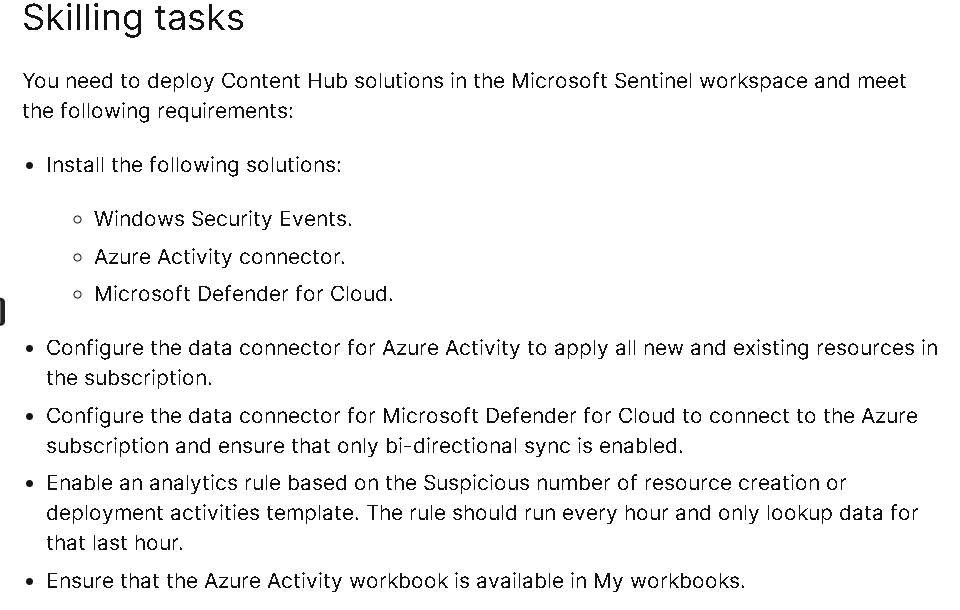
</div>

---

## 🏗️ Architecture

<div align="center">
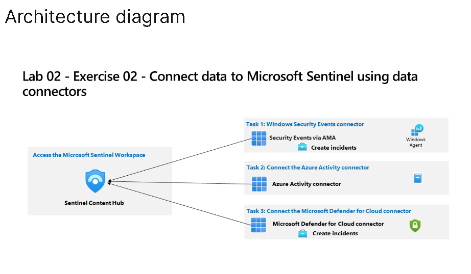
</div>

The Sentinel **Content hub** is a catalog of ready-made solutions. Each solution brings data connectors, detection rules and dashboards. Three connectors feed data into the workspace:

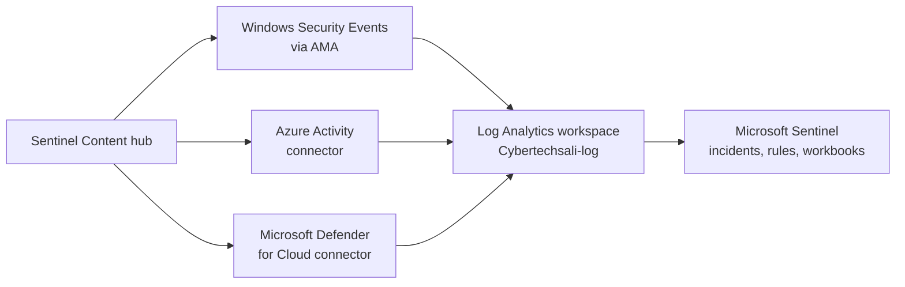

> 💡 **Analogy:** the workspace is a control room. Data connectors are the cables bringing the camera feeds in. The Content hub is the store where you buy the cables, the alarm rules and the dashboards.

---

## 📖 Key terms

| Term | Meaning |
|---|---|
| 🛍️ **Content hub** | Catalog inside Sentinel with prebuilt content from Microsoft and partners. |
| 📦 **Solution** | A package in the Content hub. It can contain data connectors, analytics rules, workbooks, hunting queries and playbooks. |
| 🧩 **Standalone content** | Single items (one rule, one workbook) that are not part of a solution. |
| 🔌 **Data connector** | The component that brings logs from a source into the workspace. |
| 🤖 **AMA (Azure Monitor Agent)** | Modern agent that collects logs from machines. **Recommended** by Microsoft. |
| 🕰️ **Legacy agent (MMA)** | Old Log Analytics agent. Retired, not for new deployments. |
| 📜 **Azure Activity log** | Subscription-level log: who created, changed or deleted which Azure resource, plus service health and policy events. |
| ⚙️ **Diagnostic settings** | Azure setting that sends logs of a resource or subscription to a destination such as a workspace. |
| 📏 **Azure Policy** | Service that enforces rules on Azure resources. Here it applies the log-streaming setting automatically. |
| 📋 **Policy assignment** | Applying a policy definition to a **scope**. |
| 🎚️ **Scope** | Where a policy or role applies: management group, subscription, resource group or resource. |
| 🛠️ **Remediation task** | Applies a policy to **existing** resources. Without it, the policy affects only newly created resources. |
| 🪪 **Managed identity** | Identity Azure gives to the policy so it can deploy the settings for you. |
| 🔄 **Bi-directional sync** | Changes to an alert or incident in one product (for example closing it in Sentinel) are mirrored in the other (Defender for Cloud). |
| 🚨 **Analytics rule** | A query that runs on a schedule and creates alerts and incidents when it finds a match. |
| ⏱️ **Query scheduling** | Two settings of a scheduled rule: **Run query every** (how often) and **Lookup data from the last** (how far back). |
| 🗺️ **MITRE ATT&CK** | Public framework of attacker tactics and techniques. Rules are tagged with it (this one: tactic *Impact*, technique T1496). |
| 🧯 **Alert grouping** | Option to group related alerts into one incident to reduce noise. |
| 🤖 **Automation rule** | Rule that reacts to incidents automatically, for example by running a playbook. |
| 📊 **Workbook** | An interactive dashboard built on workspace data. |
| 🔎 **Hunting query** | A query used by analysts to look for threats manually. |

---

## 📦 Task 1: Install the Content hub solutions

> 🎯 **Goal:** install the three solutions the scenario asks for.

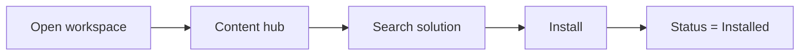

### 1️⃣ Open the Sentinel workspace

In Microsoft Sentinel, click the workspace `Cybertechsali-log` (resource group `rg2`, location **West US**).

<div align="center">
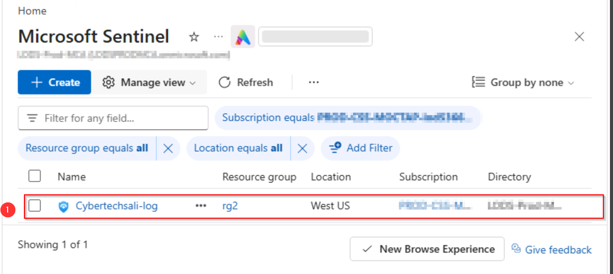
</div>

### 2️⃣ Open the Content hub

In the left menu, expand **Content management** and click **Content hub**. At this point **0** solutions are installed out of **528** available.

<div align="center">
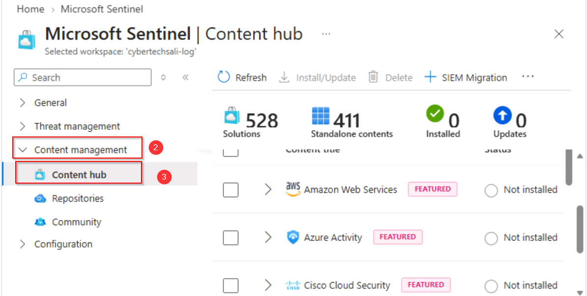
</div>

### 3️⃣ Find the Windows Security Events solution

Search for `Windows Security Events`, tick the solution and read the side panel. It contains:

| Content | Count |
|---|---|
| Data connectors | 2 |
| Workbooks | 2 |
| Analytics rules | 21 |
| Hunting queries | 50 |

Pricing of the solution is **Free**.

<div align="center">
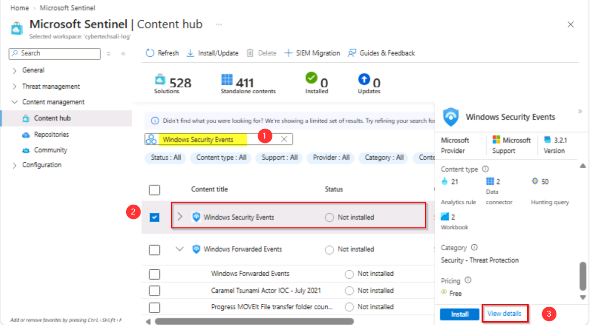
</div>

### 4️⃣ Click Create

This path uses **View details**, then **Create** on the solution page. The two connectors are:

- **Windows Security Events via AMA**: uses the new Azure Monitor Agent. **Microsoft recommends this one.**
- **Security Events via Legacy Agent**: uses the old Log Analytics agent.

<div align="center">
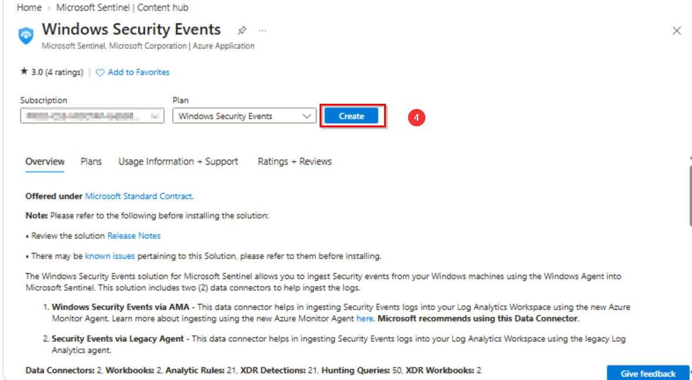
</div>

### 5️⃣ Choose the resource group and workspace

| Field | Value |
|---|---|
| Resource group | **RG2** |
| Workspace | `Cybertechsali-log` |

Click **Next** through the tabs: **Data Connectors** (2 connectors), **Workbooks** (installs workbooks) and **Analytics** (installs analytics rules). Then click **Review + create** and **Create**.

<div align="center">
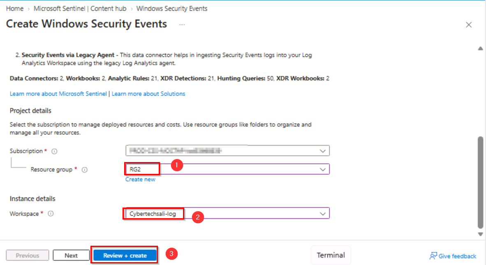
</div>

### 6️⃣ Check the result

The status of the solution and each of its items is now **Installed**, and the counter shows **1** installed.

<div align="center">
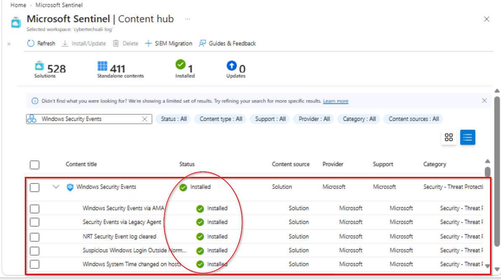
</div>

<details>
<summary>⚠️ <b>Troubleshooting: "Validation failed" with a location error (click to expand)</b></summary>

<br>

If the **Create** wizard fails with *"The provided value for the template parameter 'location' is not valid"*, the form did not pass the workspace region to the template. This is a portal issue. Your workspace and resource group are fine.

**Fix:** go back to the Content hub, select the solution and click **Install** in the side panel instead of using Create. This installs from the workspace context, so the region is passed correctly. You can also reload the page and reselect the workspace.

</details>

### 7️⃣ Install Azure Activity

Search for `Azure Activity`, tick the solution (it has 14 analytics rules, 1 data connector, 15 hunting queries and 2 workbooks), then click **Install**.

<div align="center">
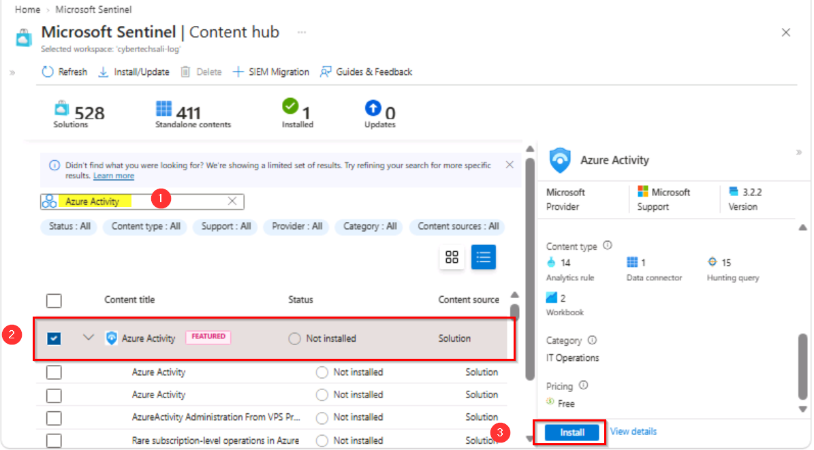
</div>

The portal shows **Install Success** and the counter goes to **2**.

<div align="center">
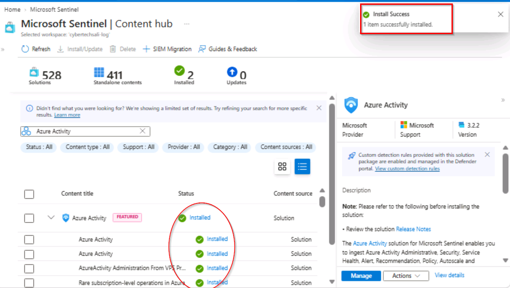
</div>

### 8️⃣ Install Microsoft Defender for Cloud

Search for `Microsoft Defender for Cloud`, tick the solution and click **Install**.

<div align="center">
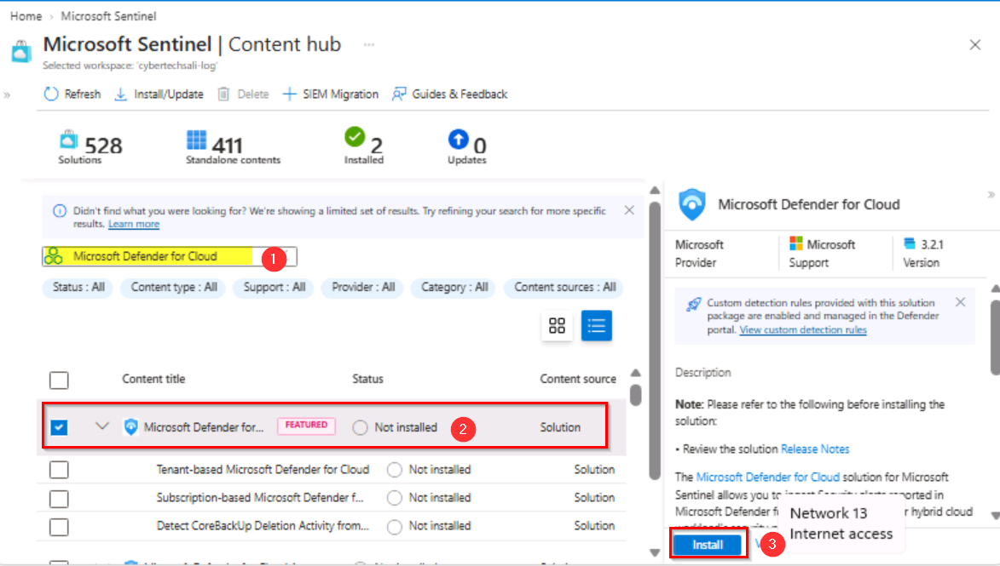
</div>

The counter goes to **3** and the solution and its items show **Installed**.

<div align="center">
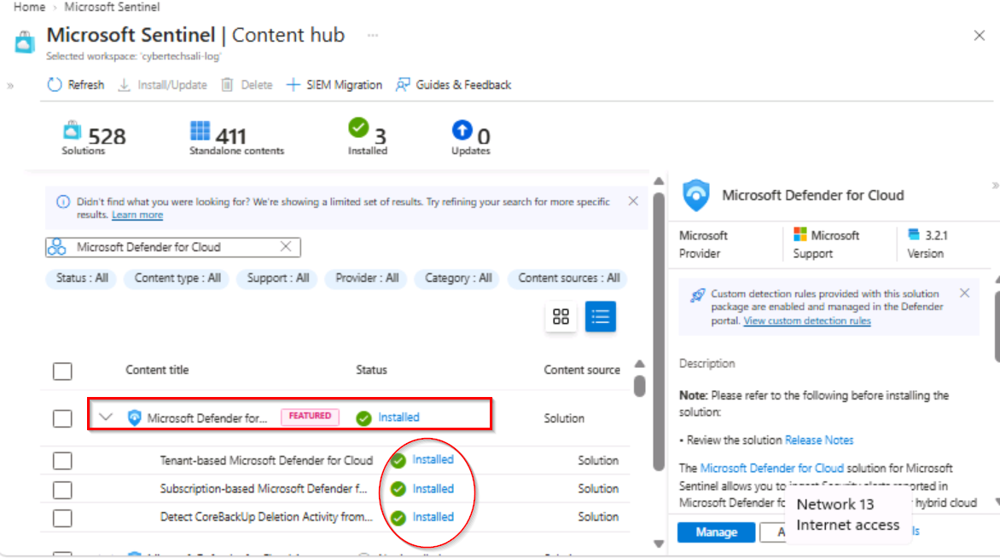
</div>

### 9️⃣ Filter the installed solutions

Click the **Status** filter, tick **Installed** and click **Apply**. Only the three solutions remain.

<div align="center">
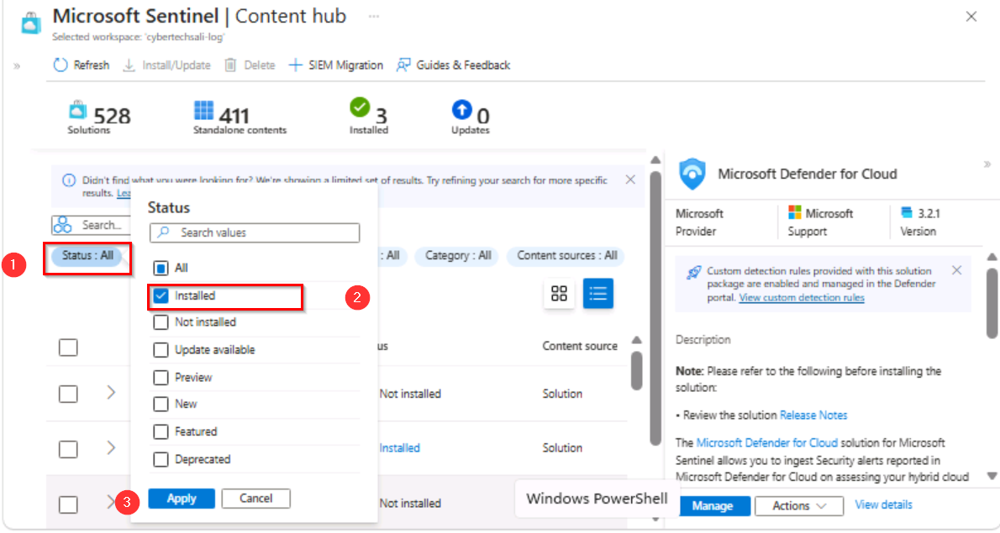
</div>

✅ **Why it matters:** "Installed" only means the package is in the workspace. **No data flows yet.** The connectors still have to be configured (Tasks 2 and 3), and the rules are templates until you enable them (Task 4).

---

## ☁️ Task 2: Configure the Azure Activity data connector

> 🎯 **Goal:** send the Azure Activity log of the **whole subscription**, for new and existing resources, to the workspace.

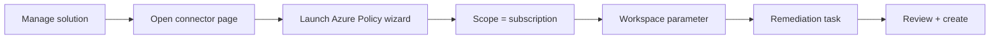

### 1️⃣ Open the solution with Manage

Select **Azure Activity** in the installed list and click **Manage**.

<div align="center">
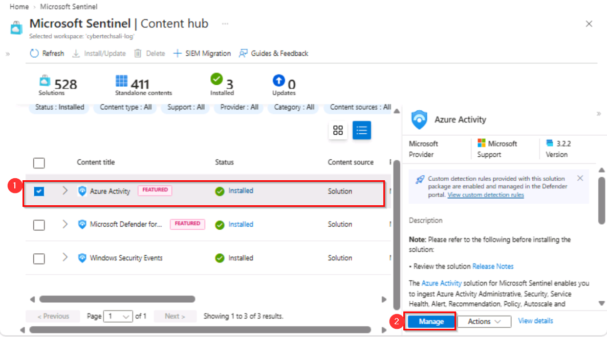
</div>

### 2️⃣ Open the connector page

In the list of content, select the **Azure Activity** data connector. Its status is **Disconnected** and no data has been received. Click **Open connector page**.

<div align="center">
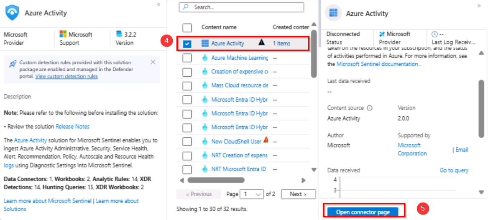
</div>

### 3️⃣ Launch the Azure Policy Assignment wizard

The page offers a new method: it uses **Azure Policy** to apply one log-streaming configuration to a collection of subscriptions. The legacy method is not used here ("You don't have subscriptions using the legacy method"). Click **Launch Azure Policy Assignment wizard**.

<div align="center">
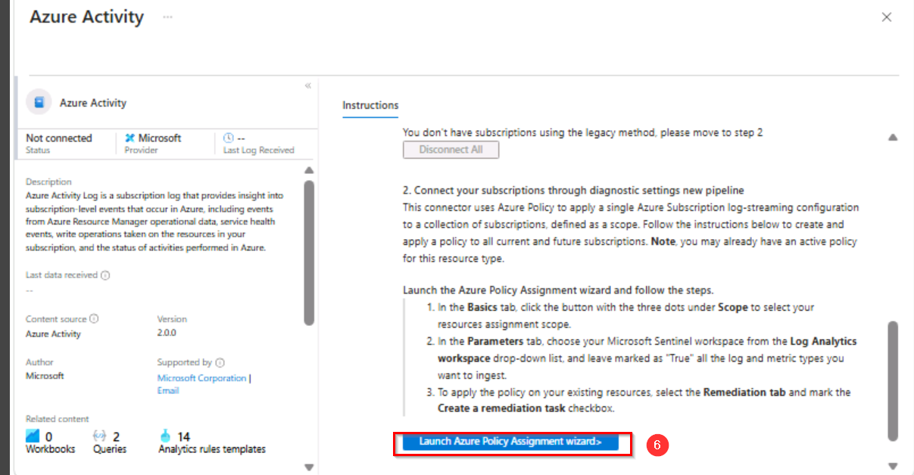
</div>

### 4️⃣ Basics tab: choose the scope

Click the `...` button next to **Scope**, select your **subscription** and click **Select**. The policy definition is *Configure Azure Activity logs to stream to specified Log Analytics workspace*.

<div align="center">
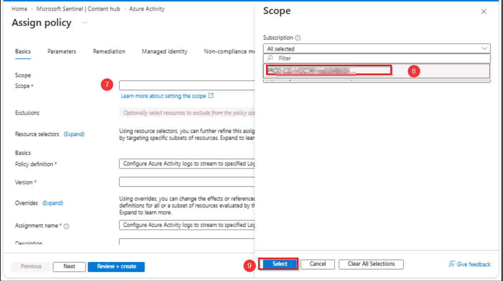
</div>

### 5️⃣ Parameters tab: choose the workspace

Click `...` next to **Primary Log Analytics workspace**, choose the subscription, select `Cybertechsali-log` and click **Select**.

<div align="center">
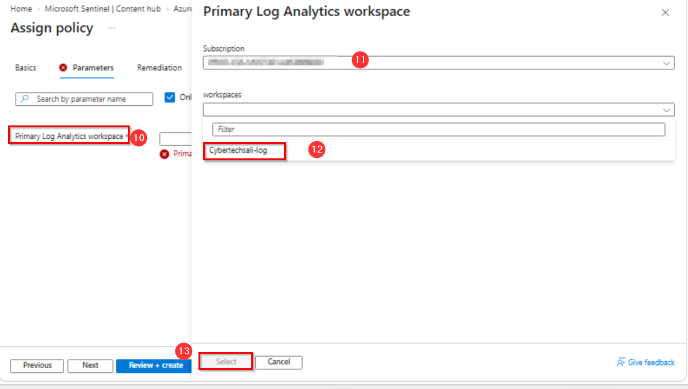
</div>

The field now shows `Cybertechsali-log`. Click the **Remediation** tab.

<div align="center">
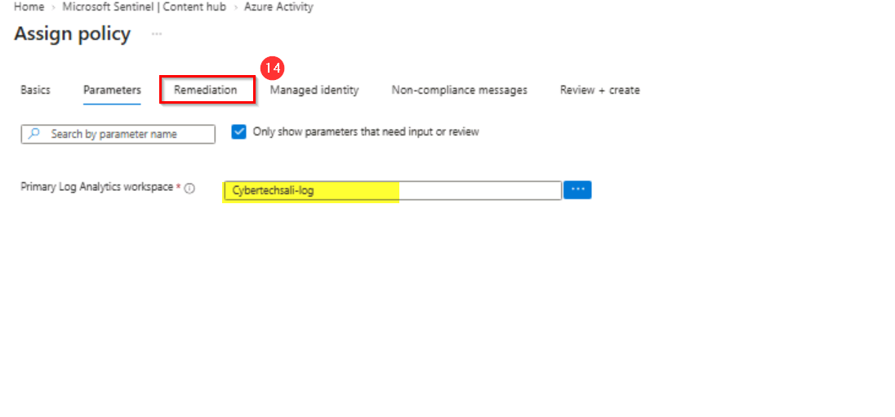
</div>

### 6️⃣ Remediation tab: cover existing resources

Tick **Create a remediation task**. By default, a policy assignment only affects **newly created** resources. The remediation task brings **existing** resources into compliance. This is what satisfies the requirement *"all new and existing resources"*.

Then click **Review + create**.

<div align="center">
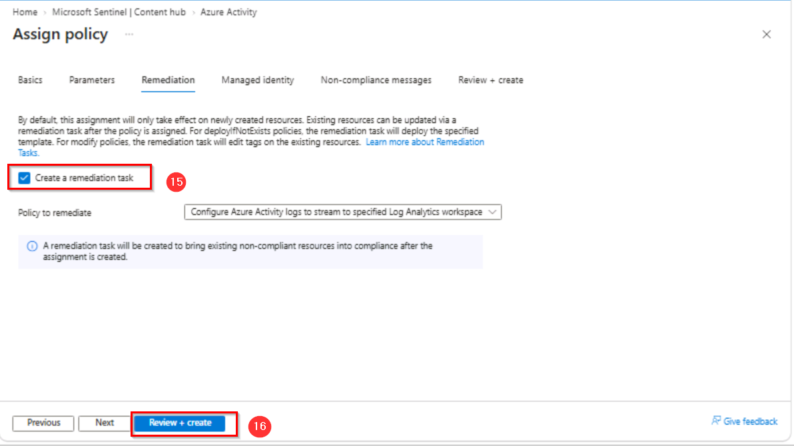
</div>

### 7️⃣ Review and create the assignment

The summary confirms:

| Setting | Value |
|---|---|
| Primary Log Analytics workspace | `cybertechsali-log` |
| Create a remediation task | **Yes** |
| Create a Managed Identity | **Yes** |
| Type of Managed Identity | **System assigned managed identity** |

Click **Create**.

<div align="center">
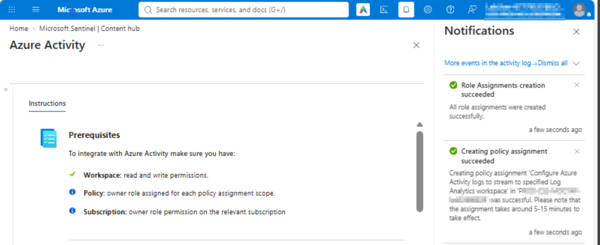
</div>

### 8️⃣ Check the notifications

Two notifications confirm the result:

- **Role Assignments creation succeeded**: the managed identity received the roles it needs to deploy the log settings.
- **Creating policy assignment succeeded**: the assignment takes around **5 to 15 minutes** to take effect.

The connector page also lists the prerequisites: **read and write** permission on the workspace, the **Owner** role for each policy assignment scope, and the **Owner** role on the subscription.

<div align="center">
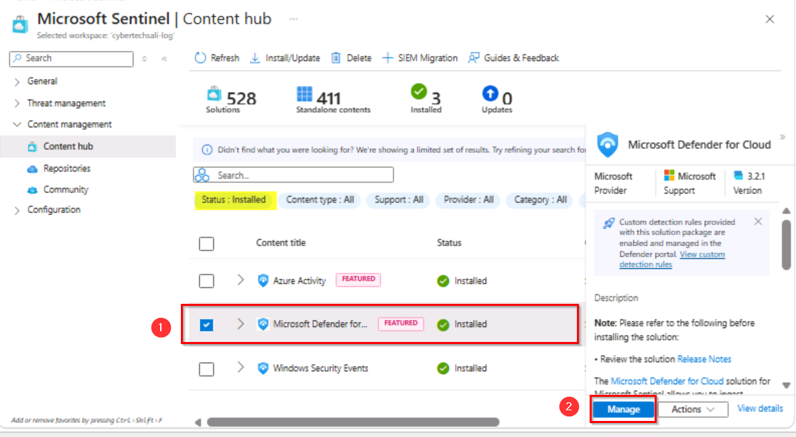
</div>

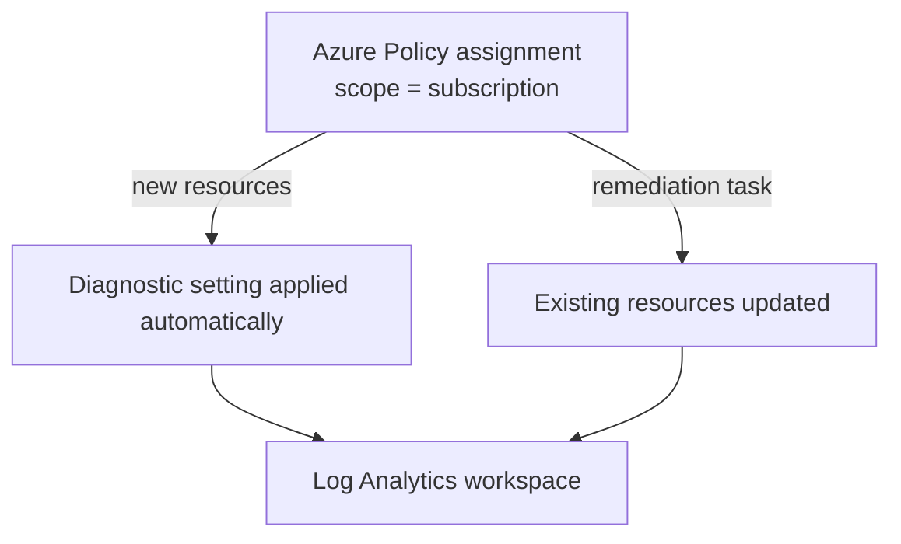

✅ **Why it matters:** one policy assignment on the subscription covers every resource, now and in the future. This is simpler and safer than configuring each resource by hand.

---

## 🛡️ Task 3: Configure the Microsoft Defender for Cloud connector

> 🎯 **Goal:** connect the Azure subscription to Sentinel and enable **only bi-directional sync**.

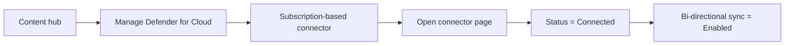

### 1️⃣ Open the solution with Manage

In the Content hub, keep the filter **Status: Installed**, select **Microsoft Defender for Cloud** and click **Manage**.

<div align="center">
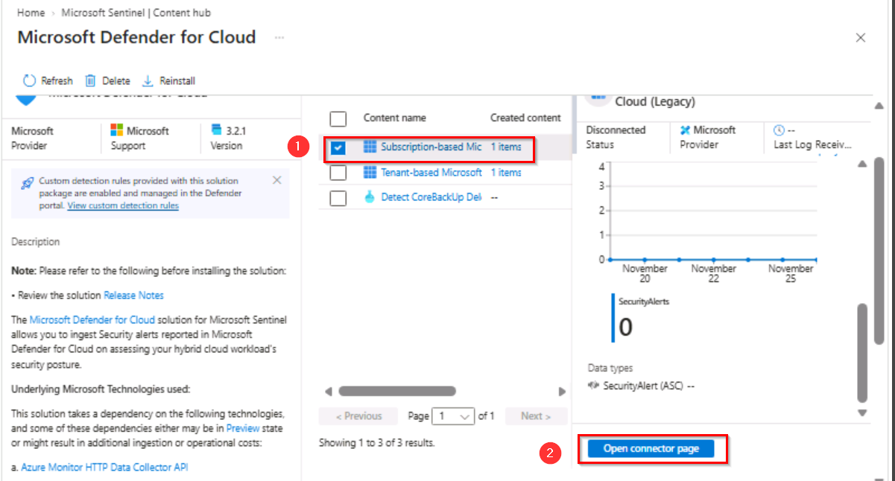
</div>

### 2️⃣ Open the connector page

The solution contains three items. Select **Subscription-based Microsoft Defender for Cloud (Legacy)**. Its status is **Disconnected**. Click **Open connector page**.

The other connector, *Tenant-based Microsoft Defender for Cloud*, connects a whole tenant. The lab asks to connect the Azure **subscription**, so the subscription-based connector is the one to use.

<div align="center">
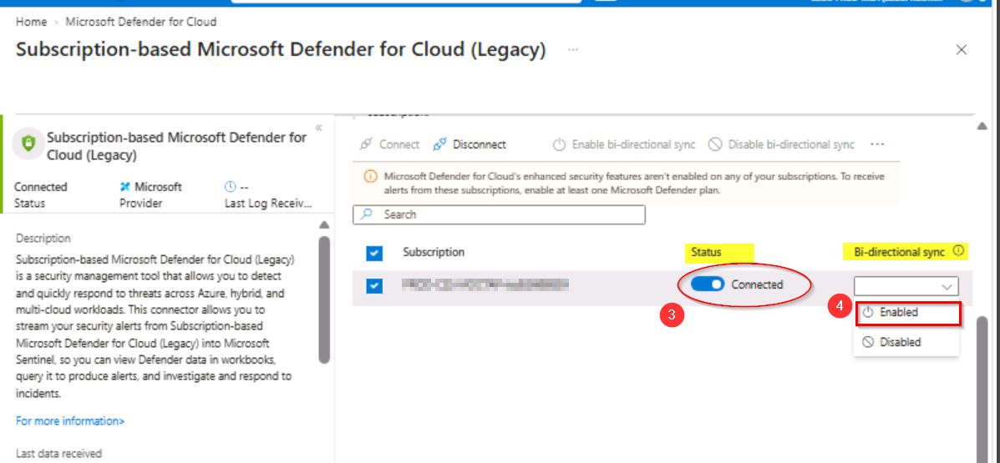
</div>

### 3️⃣ Connect the subscription and enable bi-directional sync

1. Tick your subscription.
2. Switch its **Status** toggle to **Connected**.
3. In the **Bi-directional sync** column, choose **Enabled**.

Nothing else is changed, so bi-directional sync is the only option turned on.

<div align="center">
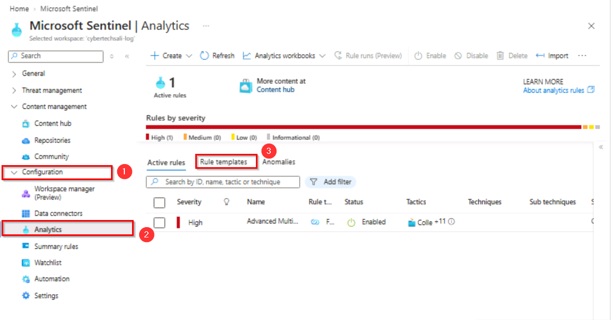
</div>

> ℹ️ The page shows a warning: *Defender for Cloud's enhanced security features are not enabled on any subscription*. The connection works, but alerts only arrive once at least one **Microsoft Defender plan** is enabled. This does not block the lab.

A notification later confirms: **Connected successfully** for *Subscription-based Microsoft Defender for Cloud (Legacy)*.

✅ **Why it matters:** with bi-directional sync, closing an incident in Sentinel also closes the matching alert in Defender for Cloud, so analysts work in one place.

---

## 🚨 Task 4: Enable an analytics rule

> 🎯 **Goal:** detect an unusual amount of resource creation or deployment, checking every hour on the last hour of data.

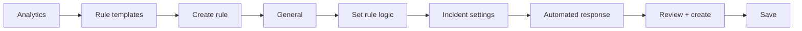

### 1️⃣ Open the rule templates

Go to **Configuration > Analytics** and click the **Rule templates** tab. Before this task, there is **1** active rule.

<div align="center">
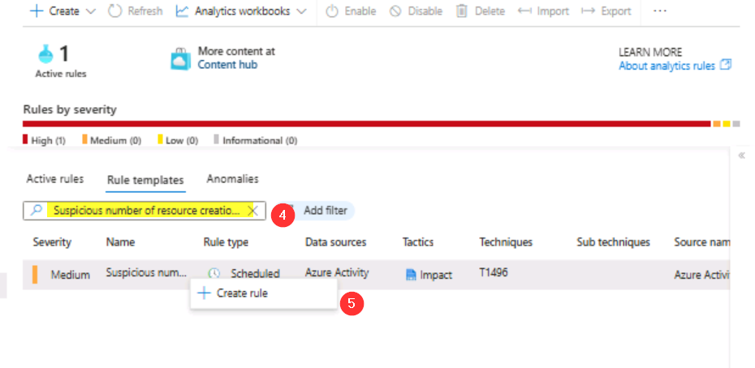
</div>

### 2️⃣ Find the template and create the rule

Search for `Suspicious number of resource creation or deployment activities`. The template is **Medium** severity, type **Scheduled**, data source **Azure Activity**, tactic **Impact**, technique **T1496**. Click **Create rule**.

<div align="center">
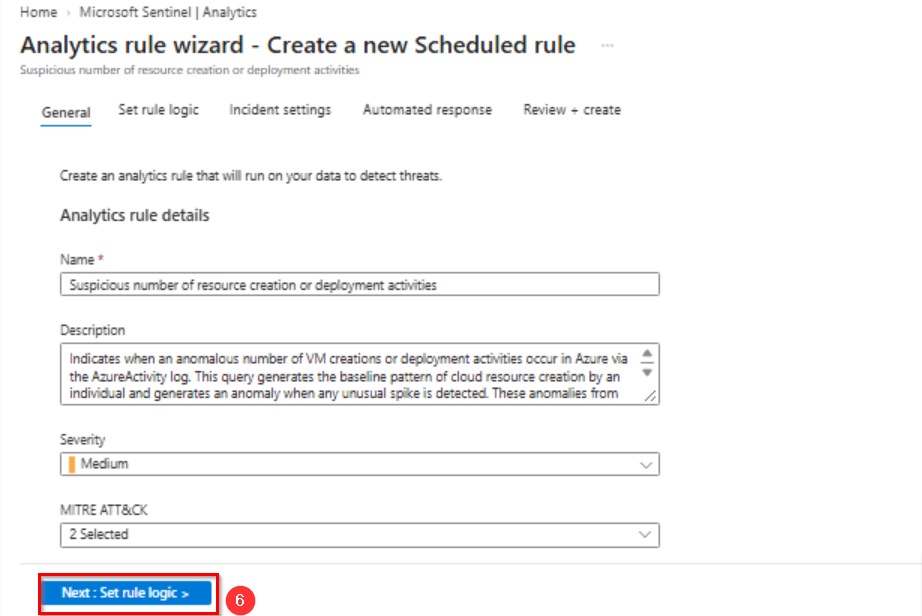
</div>

### 3️⃣ General tab

The name, description, severity (**Medium**) and MITRE ATT&CK tags (2 selected) come from the template. Click **Next: Set rule logic**.

<div align="center">
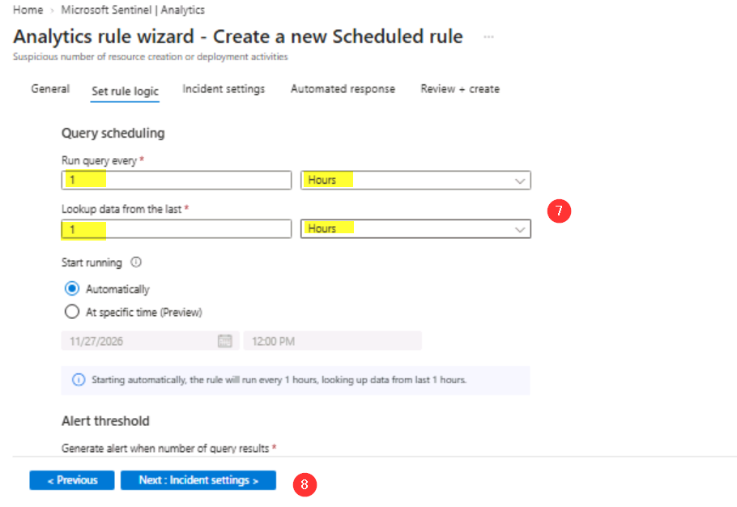
</div>

### 4️⃣ Set rule logic: the two time settings

| Setting | Value |
|---|---|
| Run query every | **1 Hours** |
| Lookup data from the last | **1 Hours** |
| Start running | **Automatically** |

The portal confirms: *Starting automatically, the rule will run every 1 hours, looking up data from last 1 hours.* Click **Next: Incident settings**.

<div align="center">
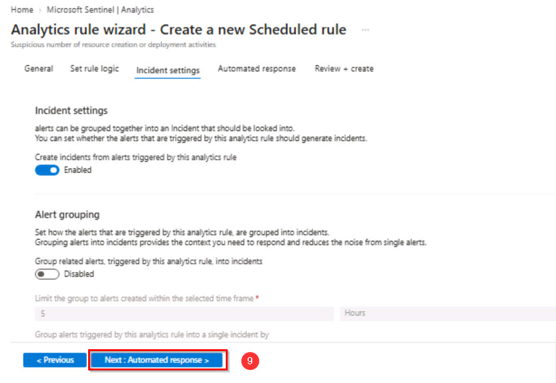
</div>

### 5️⃣ Incident settings

- **Create incidents from alerts triggered by this analytics rule**: **Enabled**.
- **Alert grouping**: **Disabled**.

Click **Next: Automated response**.

<div align="center">
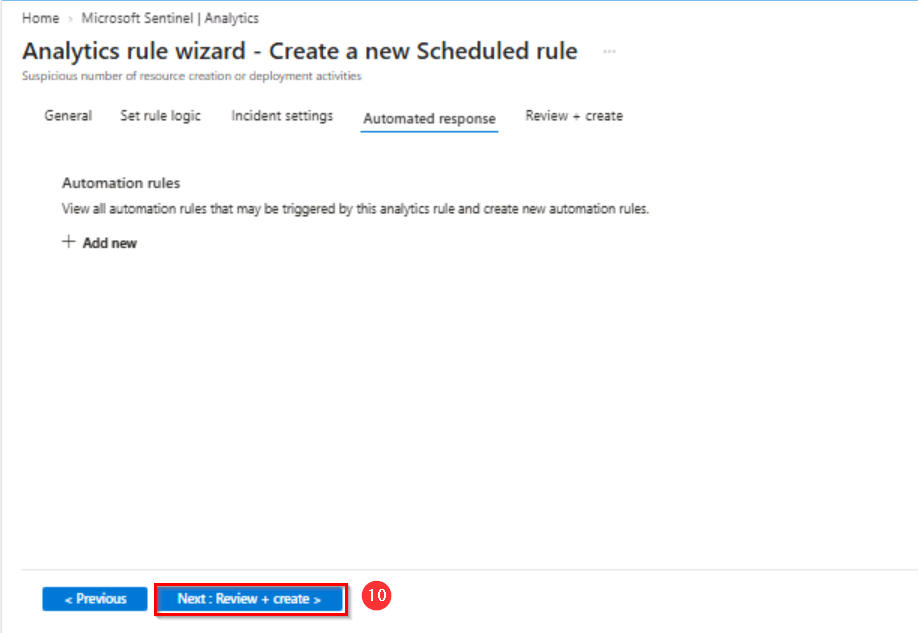
</div>

### 6️⃣ Automated response

No automation rule is added. Click **Next: Review + create**.

<div align="center">
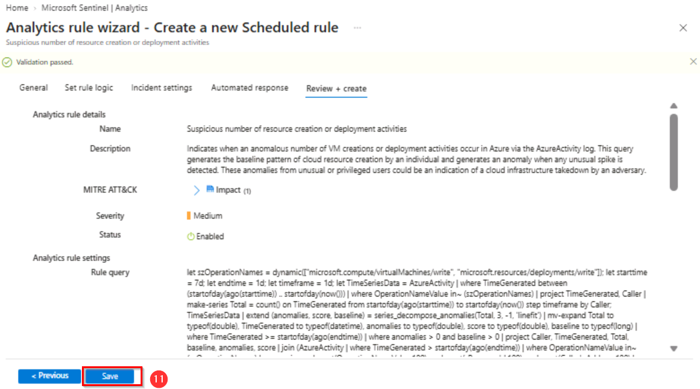
</div>

### 7️⃣ Review and save

**Validation passed**. The summary shows the severity **Medium**, the status **Enabled** and the rule query. Click **Save**.

<div align="center">
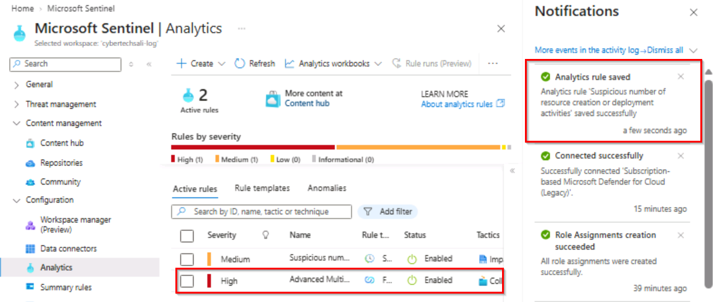
</div>

### 8️⃣ Check the result

The notification **Analytics rule saved** appears and the number of active rules goes from **1** to **2**. The new rule is listed as **Medium** and **Enabled**.

<div align="center">
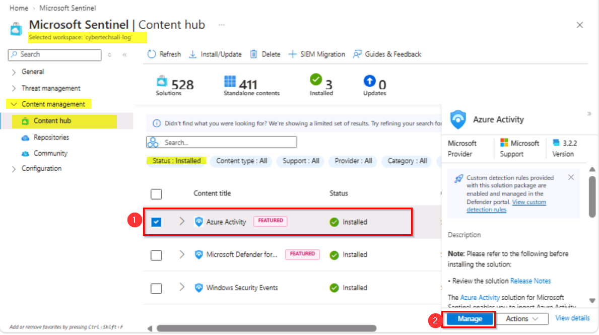
</div>

✅ **Why it matters:** the rule only works if the **Azure Activity** data connector is sending data (Task 2). The two time settings are independent: one controls how often it runs, the other how far back it looks.

---

## 📊 Task 5: Make the Azure Activity workbook available in My workbooks

> 🎯 **Goal:** the workbook that comes from the **Azure Activity** solution is saved and listed in **My workbooks**.

A workbook in the Content hub is only a **template**. It appears in **My workbooks** after you **save** it.

### 1️⃣ Open the Azure Activity solution

In the Content hub, filter by **Status: Installed**, select **Azure Activity** and click **Manage**.

<div align="center">
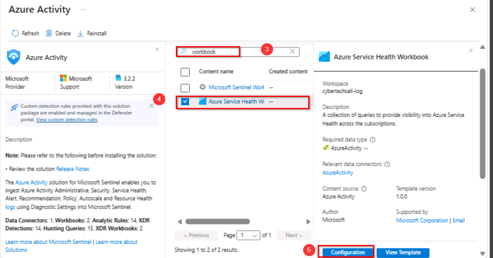
</div>

### 2️⃣ Find the workbook and open its configuration

Search for `workbook`, select **Azure Service Health Workbook** (source: Azure Activity) and click **Configuration**.

<div align="center">
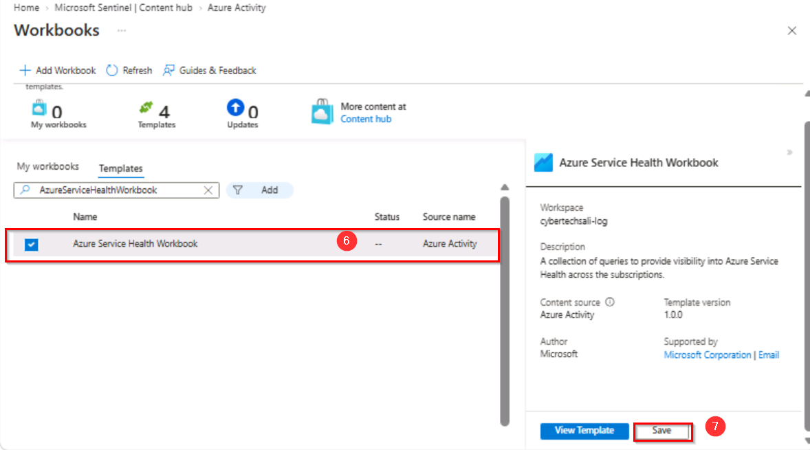
</div>

### 3️⃣ Save the template

On the **Workbooks** page, the **Templates** tab lists 4 templates and **My workbooks** shows **0**. Select the workbook and click **Save**.

<div align="center">
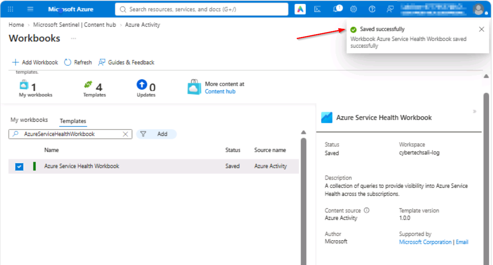
</div>

### 4️⃣ Check the result

The message **Saved successfully** appears, the status of the template is **Saved** and **My workbooks** shows **1**.

<div align="center">
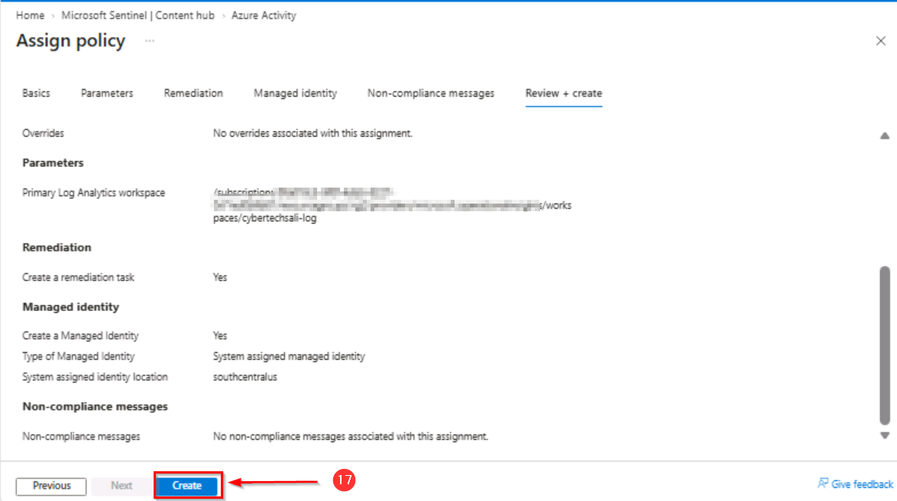
</div>

> ℹ️ In this lab, the workbook delivered by the Azure Activity solution is named **Azure Service Health Workbook** (*Source name: Azure Activity*).

---

## ✅ Final result

| Requirement | How it was met | Status |
|---|---|---|
| Install the 3 solutions | Windows Security Events, Azure Activity and Defender for Cloud installed from the Content hub | ✅ |
| Azure Activity for new and existing resources | Azure Policy assignment on the subscription + remediation task | ✅ |
| Defender for Cloud with only bi-directional sync | Subscription-based connector **Connected**, bi-directional sync **Enabled** | ✅ |
| Analytics rule every hour, last hour only | Rule created from the template with **1 Hours** and **1 Hours**, status Enabled | ✅ |
| Azure Activity workbook in My workbooks | Workbook template saved, **My workbooks = 1** | ✅ |

---

## 🧠 Exam reminders

- 📦 A **solution** installed from the Content hub does **not** send data. Configure the **data connector**.
- 🤖 For Windows security events, use **Azure Monitor Agent (AMA)**, not the legacy agent.
- 🛠️ Azure Policy applies only to **new** resources by default. Add a **remediation task** to cover **existing** ones.
- 🎚️ The **scope** of the policy decides how many subscriptions are covered.
- 🪪 The remediation task needs a **managed identity** with role assignments. Connecting needs **Owner** permissions.
- 🔄 **Bi-directional sync** mirrors alert status between Defender for Cloud and Sentinel.
- 🚨 A scheduled analytics rule has two time settings: **how often it runs** and **how far back it looks**.
- 📊 A workbook template must be **saved** to appear in **My workbooks**.

---

## 🗂️ Repo structure

```
Lab 02 - Connect data to Microsoft Sentinel using data connectors/
├── README.md
└── images/
    ├── 1.png
    ├── 2.png
    └── ... up to 37.png
```
