<div align="center">

# 🛰️ Lab 03: Configure Microsoft Sentinel Data Collection rules


*Hands-on lab documented step by step, with screenshots and explanations of every term.*

</div>

---

## 👤 About

| | |
|---|---|
| 🎯 **Goal** | Preparation for the Microsoft **SC-500** certification (Cloud and AI Security Engineer Associate) |
| ✍️ **Author** | Ouchahed Salma |
| 🐙 **GitHub** | CyberTechSali |
| 🎓 **Training** | [LevelUp for Microsoft - SC-500: Cloud and AI Security Engineer Associate - Practice Lab](https://learn.mslevelup.com/learner_module/show/2621860?lesson_id=12220419&section_id=109230742) (SkillUp) |
| 📅 **Date** | November 27, 2026 |
| 🔗 **Previous lab** | Lab 02: the Content hub solutions, including **Windows Security Events**, were installed there |

> 📌 The lab instructions, architecture diagram and lab environment are provided by the training. I performed the lab and captured the configuration screenshots.

---

## 📑 Table of contents

1. [Scenario](#-scenario)
2. [Architecture](#-architecture)
3. [Key terms](#-key-terms)
4. [Task 1: Configure the Data Collection Rule](#-task-1-configure-the-data-collection-rule)
5. [Task 2: Create the NRT analytics rule](#-task-2-create-the-nrt-analytics-rule)
6. [Task 3: Create the automation rule](#-task-3-create-the-automation-rule)
7. [Final result](#-final-result)
8. [Exam reminders](#-exam-reminders)

---

## 🎯 Scenario

Validate the Microsoft Sentinel deployment and meet these requirements:

| # | Requirement | Solved in |
|---|---|---|
| 1 | 🔌 Configure the **Windows Security Events via AMA** connector to collect **all security events** from **only VM1** | Task 1 |
| 2 | 🚨 Create a **near-real-time (NRT)** query rule that generates an incident from the provided query | Task 2 |
| 3 | 🤖 Create an **automation rule** that makes **Operator1** the owner of incidents generated by the NRT rule | Task 3 |

<div align="center">
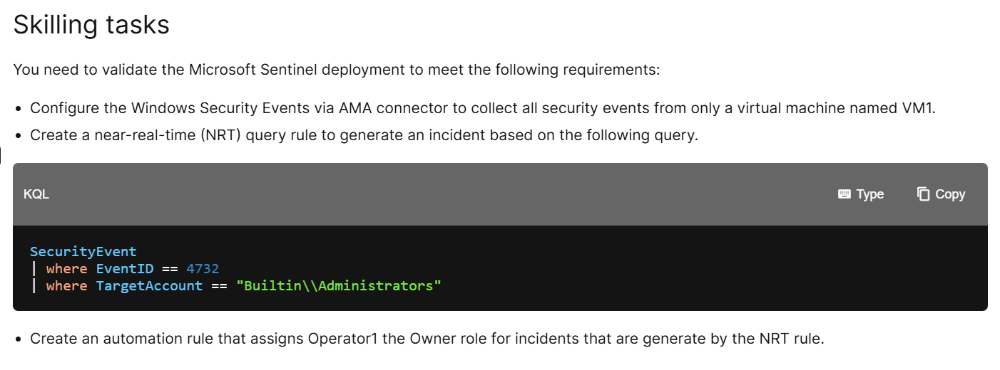
</div>

---

## 🏗️ Architecture

<div align="center">
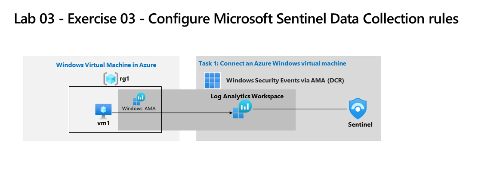
</div>

> ℹ️ The diagram shows `vm1` in `rg1`. In my lab environment, `VM1` is listed under `rg2`, and the Data Collection Rule was created in `RG2`.

The diagram covers the data collection. The full pipeline built in this lab goes further:

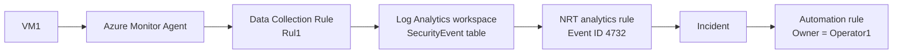

> 💡 **Analogy:** the DCR is the delivery order (what to collect and from where), the NRT rule is the alarm, and the automation rule is the dispatcher who gives the case to an analyst.

---

## 📖 Key terms

| Term | Meaning |
|---|---|
| 🔌 **Data connector** | The component that brings logs from a source into the workspace. |
| 🤖 **AMA (Azure Monitor Agent)** | Modern agent that collects logs from machines. |
| 📋 **DCR (Data Collection Rule)** | Defines which machines to collect from, which data to collect and where to send it. |
| 🪪 **Managed identity** | Identity that Azure gives to a resource so it can authenticate without stored passwords. |
| 🗄️ **SecurityEvent** | Workspace table that stores the Windows security events used in this lab. |
| 🔢 **Event ID 4732** | A member was added to a security-enabled local group. |
| 👑 **Builtin\\Administrators** | The local group with full control of a Windows machine. |
| 🔎 **KQL** | Kusto Query Language, used to query the logs. |
| ⚡ **NRT rule** | Near-real-time analytics rule that runs once every minute. |
| 🧾 **Incident** | A case created from one or more alerts for investigation. |
| 🧯 **Alert grouping** | Option to group related alerts into one incident to reduce noise. |
| ⚙️ **Automation rule** | Rule that handles incidents or alerts automatically, for example by assigning an owner. |
| 🙋 **Incident owner** | The person responsible for the incident. It is **not** the Azure RBAC **Owner** role. |

---

## 🔌 Task 1: Configure the Data Collection Rule

> 🎯 **Goal:** collect **all security events** from **VM1 only**.

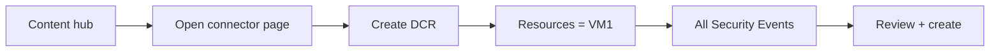

### 1️⃣ Open the connector from the Content hub

In the workspace `Cybertechsali-log`, go to **Content management > Content hub** and search for `Windows Security Events via AMA`. Tick the connector and click **Open connector page**.

<div align="center">
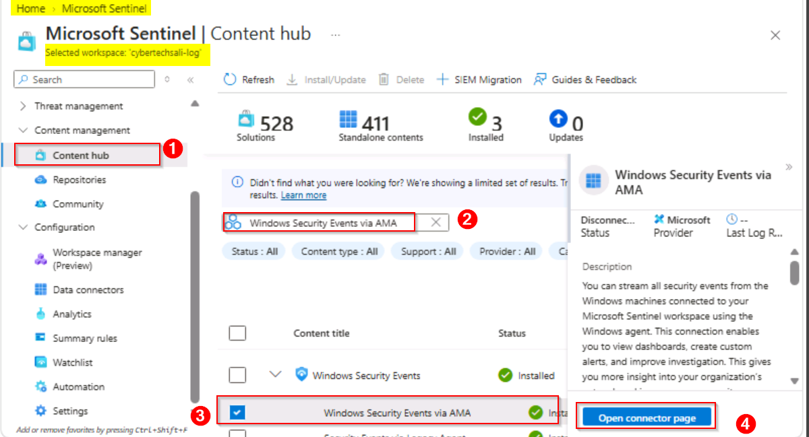
</div>

### 2️⃣ Create a data collection rule

The connector is **Disconnected** and the rule list is empty. Click **+Create data collection rule**.

<div align="center">
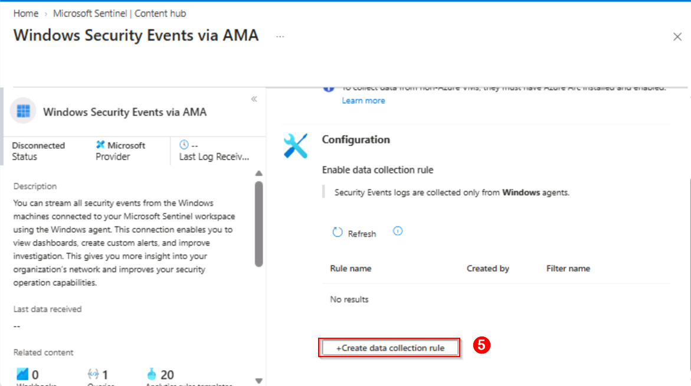
</div>

### 3️⃣ Basic tab

| Field | Value |
|---|---|
| Rule name | `Rul1` |
| Resource group | **RG2** |

Select the subscription, then click **Next: Resources**.

<div align="center">
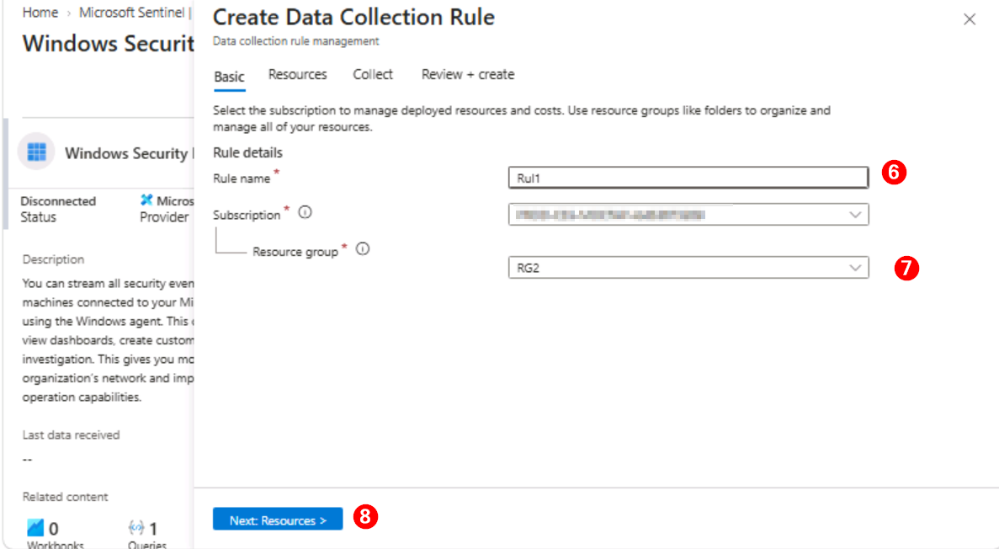
</div>

### 4️⃣ Resources tab: select VM1

Select **VM1** (South Central US). The Azure Monitor Agent is installed automatically, and a system-assigned managed identity is enabled on the machine. Click **Next: Collect**.

> ⚠️ The subscription and `rg2` boxes also appear ticked in this capture. The requirement is **VM1 only**, so check the resource list on the review tab.

<div align="center">
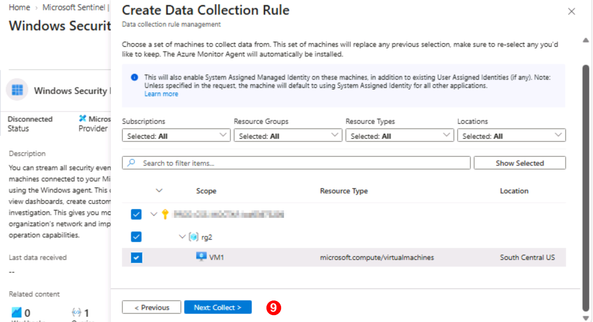
</div>

### 5️⃣ Collect tab: choose the events

Select **All Security Events**, then click **Next: Review + create**. The other choices are **Common**, **Minimal** and **Custom**.

<div align="center">
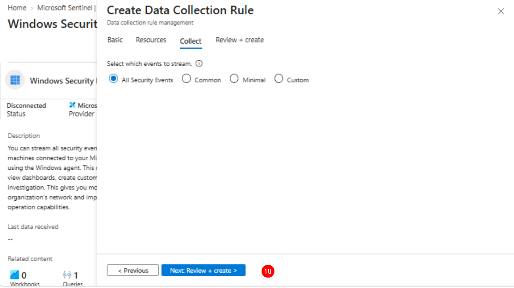
</div>

### 6️⃣ Review and create

**Validation passed**. The only listed resource is `vm1` and the selected events are **AllEvents**. Click **Create**.

<div align="center">
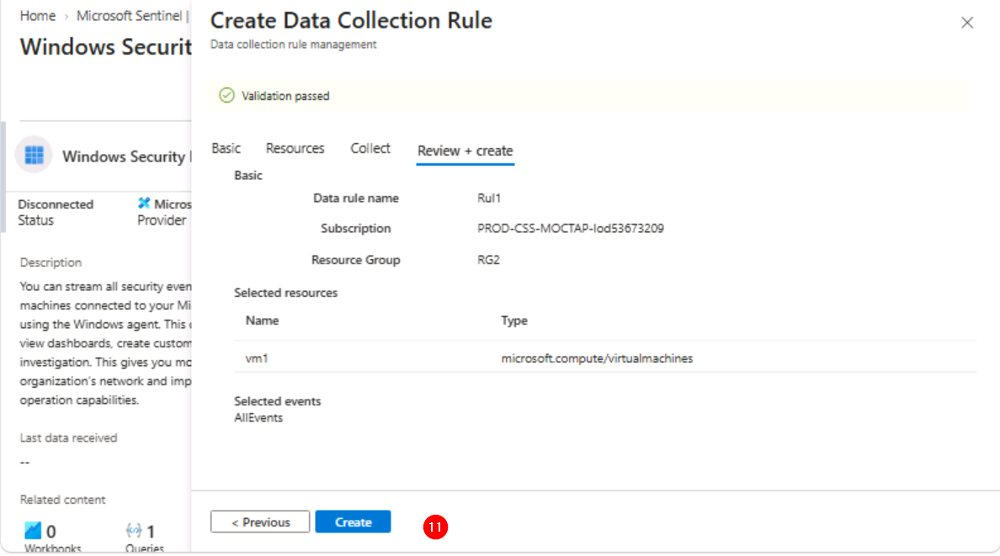
</div>

### 7️⃣ Check the notifications

Two notifications confirm the result:

- **Successfully installed extension** on `vm1`.
- **Create Data Collection Rule Association Succeeded** for `Rul1`.

At this moment the connector still shows **Disconnected** and the rule list has not shown `Rul1` yet.

<div align="center">
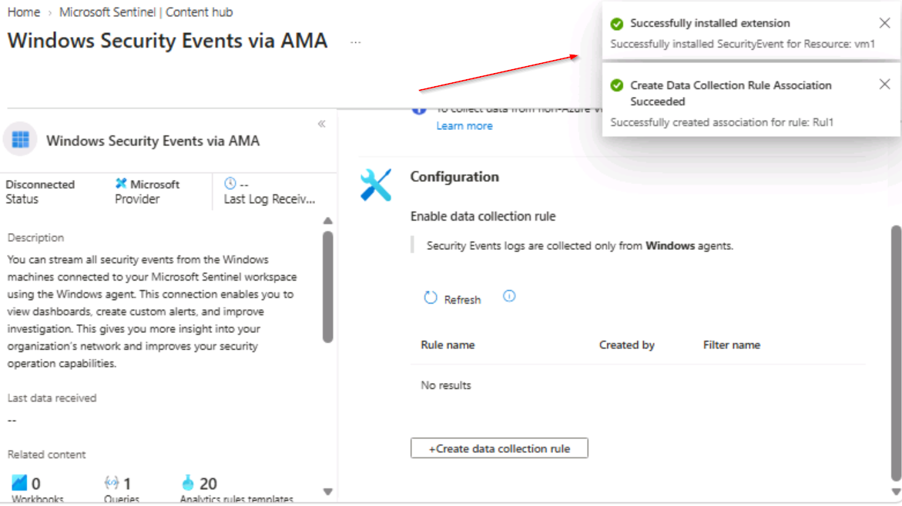
</div>

✅ **Why it matters:** the DCR controls exactly which machines send which events. A successful deployment does **not** prove that logs are arriving.

<details>
<summary>⚠️ <b>Troubleshooting: connector still "Disconnected" (click to expand)</b></summary>

<br>

Wait a few minutes and click **Refresh**. Check that VM1 is running, that the agent extension is installed and that `Rul1` is associated with VM1. Then run this query in **Logs**:

```kusto
SecurityEvent
| where TimeGenerated > ago(30m)
| summarize Events = count(), LastEvent = max(TimeGenerated) by Computer
```

</details>

---

## 🚨 Task 2: Create the NRT analytics rule

> 🎯 **Goal:** create an incident when a member is added to the local **Administrators** group.

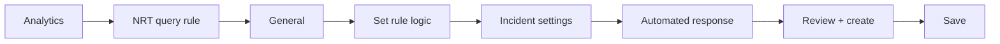

### 1️⃣ Open the NRT wizard

Go to **Configuration > Analytics**, click **+ Create** and select **NRT query rule**.

<div align="center">
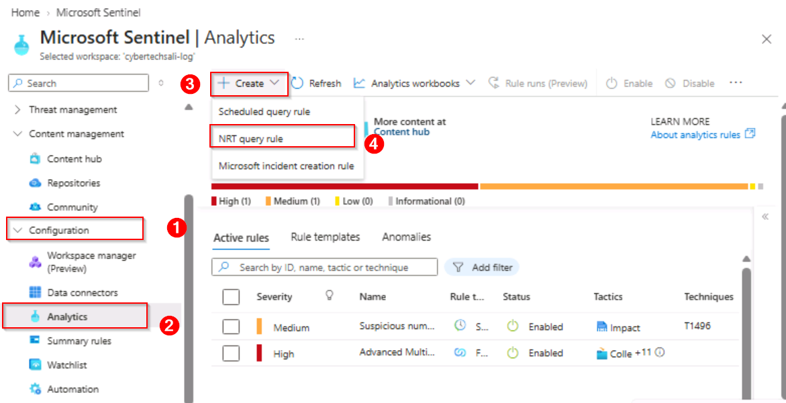
</div>

### 2️⃣ General tab: name and severity

| Field | Value |
|---|---|
| Name | `Rule-1-cybertechsali` |
| Severity | **Medium** |

<div align="center">
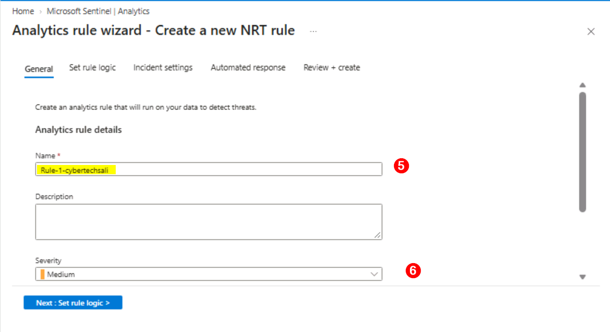
</div>

### 3️⃣ General tab: tactics and status

The **Tactics and techniques** field is shown here. No MITRE ATT&CK tag was selected. Keep the status **Enabled** and click **Next: Set rule logic**.

<div align="center">
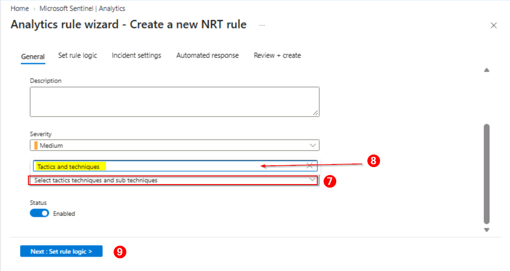
</div>

### 4️⃣ Set rule logic: the query

```kusto
SecurityEvent
| where EventID == 4732
| where TargetAccount == "Builtin\\Administrators"
```

| Line | Meaning |
|---|---|
| `SecurityEvent` | Read the Windows security events table |
| `EventID == 4732` | Keep additions to a local security group |
| `TargetAccount == ...` | Keep only the Administrators group. `\\` represents one backslash, and `==` is case-sensitive |

Windows records this event only if auditing of **Security Group Management** is enabled. Click **Next: Incident settings**.

<div align="center">
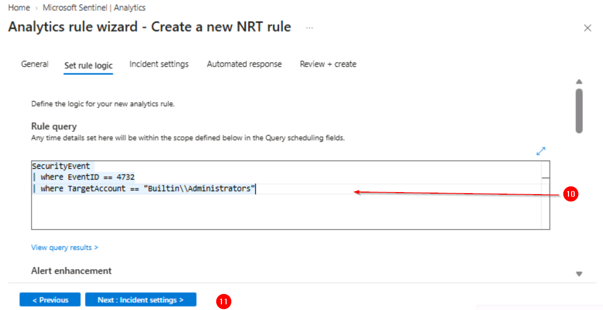
</div>

### 5️⃣ Incident settings

- **Create incidents from alerts triggered by this analytics rule**: **Enabled**.
- **Alert grouping**: **Disabled**.

<div align="center">
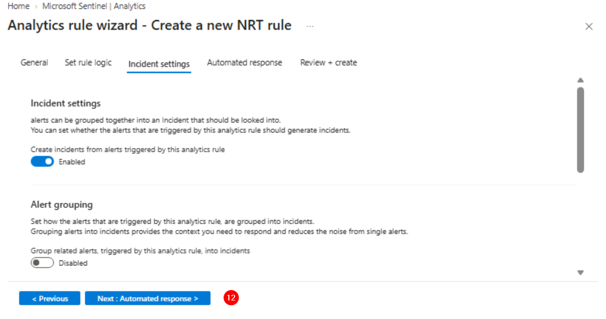
</div>

### 6️⃣ Automated response

No automation rule is added here. It is created in Task 3. Click **Next: Review + create**.

<div align="center">
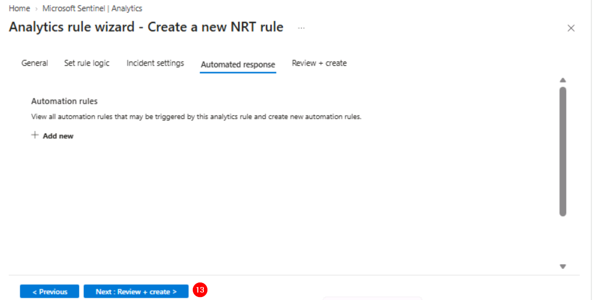
</div>

### 7️⃣ Review and save

**Validation passed**. The severity is **Medium**, the status is **Enabled** and event grouping is **Trigger an alert for each event**. Click **Save**.

<div align="center">
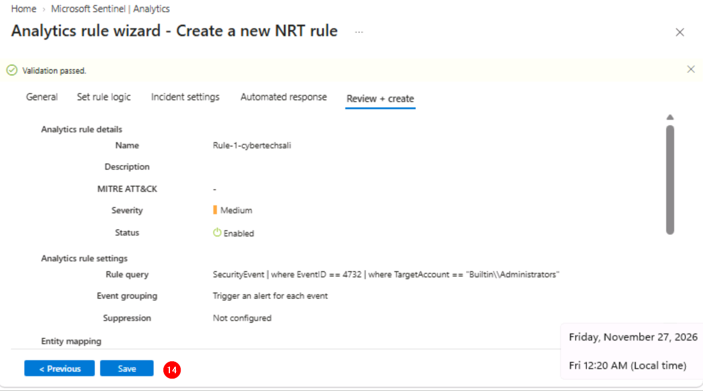
</div>

### 8️⃣ Check the result

The notification **Analytics rule saved** appears. There are now **3** active rules, and the new NRT rule is **Enabled**.

<div align="center">
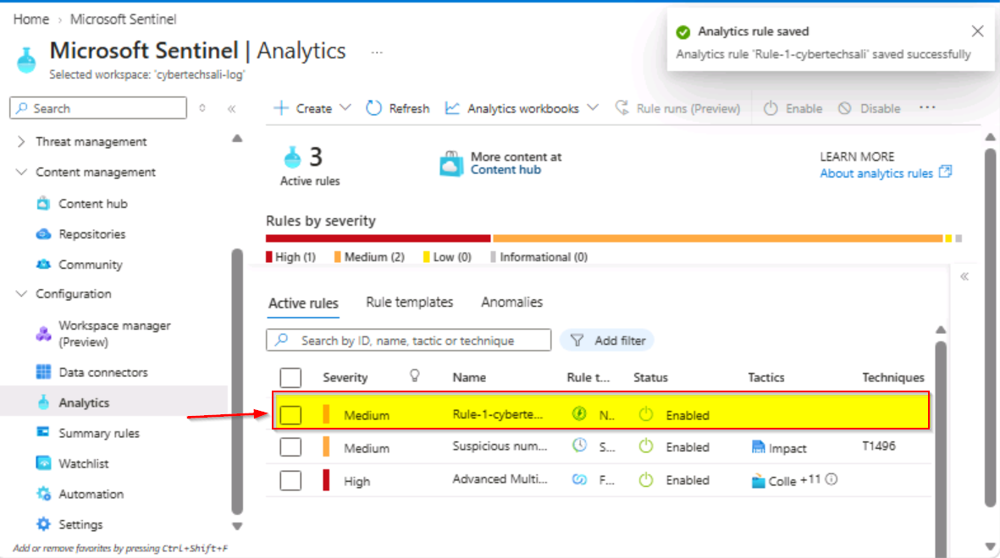
</div>

✅ **Why it matters:** a new local administrator can mean privilege escalation or persistence. An NRT rule shortens the detection delay, although it still depends on log ingestion.

---

## 🤖 Task 3: Create the automation rule

> 🎯 **Goal:** assign **Operator1** as the owner of incidents from the NRT rule.

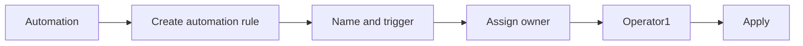

### 1️⃣ Open Automation

Go to **Configuration > Automation**, click **+ Create** and select **Automation rule**.

<div align="center">
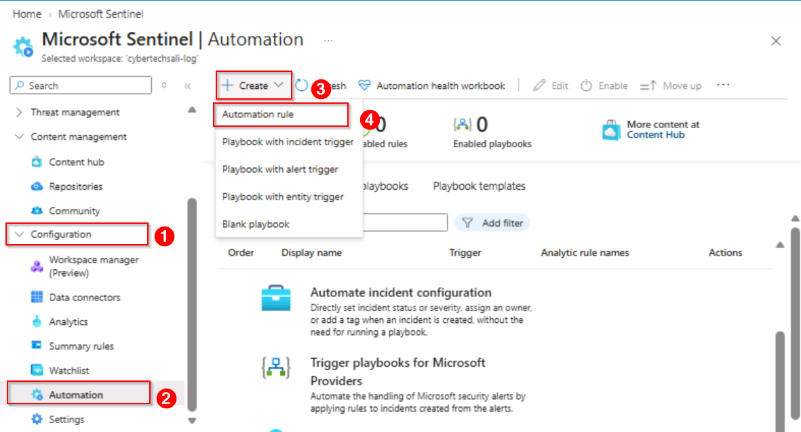
</div>

### 2️⃣ Name the rule and choose the action

Enter the name `Auto-rule1-sali`, keep the trigger **When incident is created**, then choose the action **Assign owner**.

<div align="center">
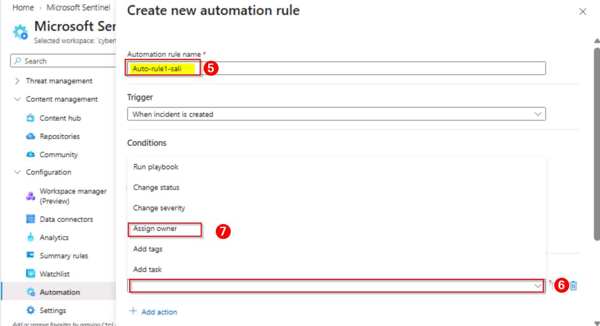
</div>

### 3️⃣ Select the incident owner

Search for and select **Operator1**. Rule expiration stays **Indefinite** and the order is **1**. Click **Apply**.

<div align="center">
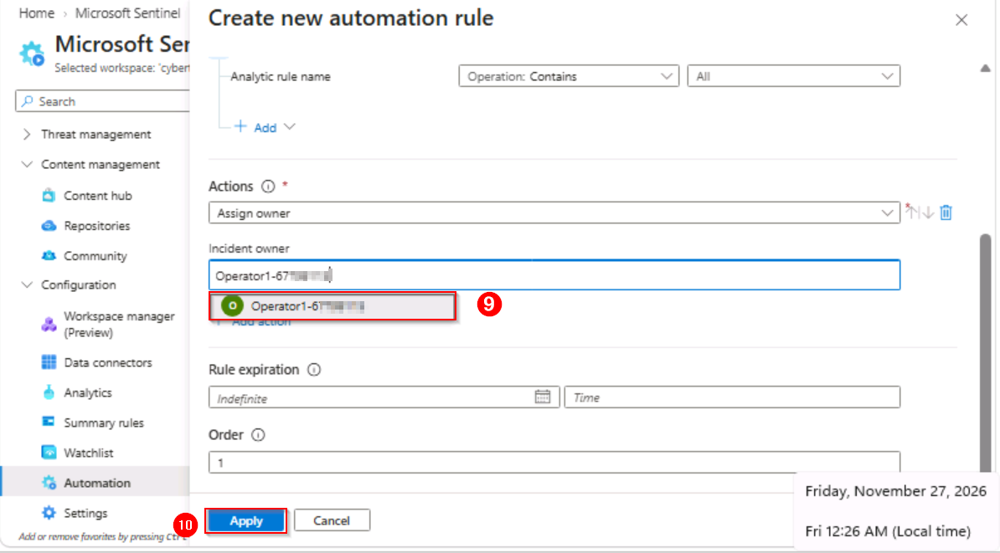
</div>

### 4️⃣ Check the result

The rule `Auto-rule1-sali` is saved and enabled.

<div align="center">
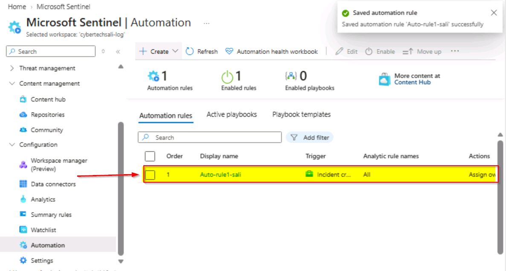
</div>

> ⚠️ **Correction needed:** the capture shows **Analytic rule names: All**, so the rule applies to incidents from every analytics rule. To meet the requirement, edit the rule, set the condition **Analytic rule name > Contains** to **only** `Rule-1-cybertechsali`, and click **Apply**. The screenshot above was taken before this correction.

✅ **Why it matters:** automatic assignment gives each incident a clear owner. The condition limits the rule to the right incidents.

---

## ✅ Final result

| Requirement | How it was met | Status |
|---|---|---|
| All security events from VM1 only | DCR `Rul1` with **AllEvents**, `vm1` listed on the review tab | ✅ Configured |
| NRT rule that generates an incident | `Rule-1-cybertechsali` saved, incident creation **Enabled** | ✅ Configured |
| Operator1 owns incidents from the NRT rule | `Auto-rule1-sali` assigns the owner, but its scope is **All** | ⚠️ Scope to correct |

> ℹ️ These screenshots show the configuration. They do not show log ingestion, a triggered incident or its assignment.

---

## 🧠 Exam reminders

- 📋 A **DCR** defines the machines, the data and the destination.
- 🤖 For Windows security events, use **AMA**, not the legacy agent.
- 🌐 **Non-Azure** machines need **Azure Arc** before AMA can be used with them.
- 🔎 Event ID **4732** means a member was added to a security-enabled **local** group.
- ⚡ **NRT** rules run **every minute**.
- 🎚️ Check the **Analytic rule name** condition of an automation rule.
- 🙋 **Incident owner** and the Azure **Owner** role are different things.

---

## 🗂️ Repo structure

```
SC-500/
└── Lab 03:Configure Microsoft Sentinel Data Collection rules/
    ├── Readme.md
    └── images/
        ├── 1.png
        ├── 2.png
        └── ... up to 21.png
```
